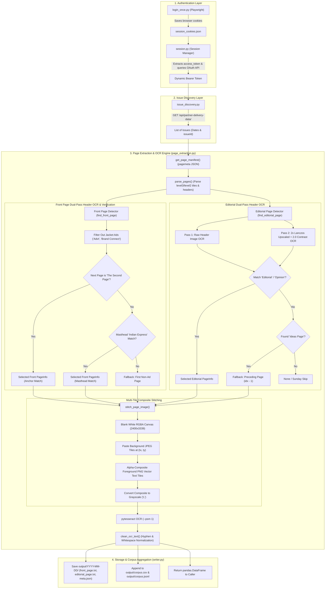

# Indian Express Historical E-Paper Scraper & OCR Pipeline: Complete Technical Walkthrough

A comprehensive reference guide explaining the architecture, implementation mechanics, execution instructions, and output structure of the Indian Express Historical E-Paper Scraper and OCR pipeline.

---

## Table of Contents
1. [Overview & Purpose](#1-overview--purpose)
2. [End-to-End System Architecture](#2-end-to-end-system-architecture)
3. [Component-by-Component Walkthrough](#3-component-by-component-walkthrough)
   - [Authentication & Dynamic Token Generation](#31-authentication--dynamic-token-generation)
   - [Issue Discovery & Date Resolution](#32-issue-discovery--date-resolution)
   - [Page Manifest Parsing & Resolution Tiers](#33-page-manifest-parsing--resolution-tiers)
   - [Dual-Pass Header OCR & Editorial Detection](#34-dual-pass-header-ocr--editorial-detection)
   - [Composite Multi-Layer Tile Stitching](#35-composite-multi-layer-tile-stitching)
   - [OCR Text Extraction & NLP Cleaning](#36-ocr-text-extraction--nlp-cleaning)
   - [Data Storage & Corpus Export](#37-data-storage--corpus-export)
4. [File & Module Summary](#4-file--module-summary)
5. [Prerequisites & Setup](#5-prerequisites--setup)
6. [How to Run the Pipeline](#6-how-to-run-the-pipeline)
   - [Step 1: One-Time Login](#step-1-one-time-login)
   - [Step 2: Running via Command Line (CLI)](#step-2-running-via-command-line-cli)
   - [Step 3: Programmatic Python Usage for Topic Modeling](#step-3-programmatic-python-usage-for-topic-modeling)
7. [Output Structure & Data Schema](#7-output-structure--data-schema)
   - [Directory Hierarchy](#71-directory-hierarchy)
   - [meta.json Schema](#72-metajson-schema)
   - [Central Corpus Files (`corpus.csv` & `corpus.jsonl`)](#73-central-corpus-files)
   - [In-Memory pandas DataFrame](#74-in-memory-pandas-dataframe)
8. [Edge Cases & Error Handling](#8-edge-cases--error-handling)

---

## 1. Overview & Purpose

Historical newspaper archives present unique engineering challenges for NLP and Topic Modeling (LDA, NMF, BERTopic):
- **Dynamic layout**: Editorial and Opinion pages move across different page numbers daily depending on advertising loads and edition sizes.
- **Complex web delivery**: Modern digital e-papers do not serve simple PDFs; they serve high-resolution tiled images composed of separate photographic background rasters and vector text overlay masks.
- **Session authentication**: Behind paywalls requiring subscriber cookie persistence and dynamic OAuth Bearer tokens.

This pipeline provides a fully automated solution: it discovers historical editions across date ranges, identifies the Front Page and Editorial Page through intelligent dual-pass header OCR, stitches high-resolution multi-tile composites, performs clean OCR extraction, and formats the output into ready-to-use NLP datasets.

---

## 2. End-to-End System Architecture



---

## 3. Component-by-Component Walkthrough
### 3.1 Authentication & Dynamic Token Generation
- **Source Files**: [`login_once.py`](file:///Users/user/Downloads/files%20(1)/login_once.py), [`session.py`](file:///Users/user/Downloads/files%20(1)/session.py)
- **Mechanism**:
  1. `login_once.py` opens a visible Chromium browser via Playwright. When the user logs in and presses Enter, all cookies are captured to `session_cookies.json`.
  2. `session.py` creates an HTTP `requests.Session` with a modern browser User-Agent and connection pooling.
  3. It extracts `access_token` (or `exp_token_jwt`) from the saved cookies and makes an authenticated GET request:
     $$\text{GET } \text{https://authentication.indianexpress.com/api/vendor/2/oauth-user/?token=}\{\text{access\_token}\}$$
  4. The endpoint returns a JSON payload containing an active Bearer token.
  5. The session sets `session.headers["Authorization"] = f"Bearer {bearer_token}"`, enabling seamless access to ecommerce delivery and manifest endpoints without triggering bot blocks.

---

### 3.2 Issue Discovery & Date Resolution
- **Source File**: [`issue_discovery.py`](file:///Users/user/Downloads/files%20(1)/issue_discovery.py)
- **Mechanism**:
  - The historical archive delivers issues month-by-month through the partner delivery API:
    ```
    GET https://ecommerce.indianexpress.com/api/partner-delivery-data/?productId=4288&month={M}&year={Y}&size=31
    ```
    *(where `4288` is the edition ID for Jaipur, configurable in `config.py`)*.
  - `get_issues_for_range(session, start_date, end_date)` steps through months from `start_date` to `end_date`, deduplicates issue IDs, parses timestamps/dates into `datetime.date` objects, and returns a chronologically sorted list of `Issue(issue_id, name, date)`.
  - Implements automatic retry backoff for network resilience.

---

### 3.3 Page Manifest Parsing & Resolution Tiers
- **Source Files**: [`page_extraction.py`](file:///Users/user/Downloads/files%20(1)/page_extraction.py), [`config.py`](file:///Users/user/Downloads/files%20(1)/config.py)
- **Mechanism**:
  - For each issue ID, `get_page_manifest()` queries the pagemeta API:
    ```
    GET https://epaper.indianexpress.com/pagemeta/get/{issue_id}/1-40
    ```
  - `parse_pages()` walks the JSON manifest and extracts metadata for each broadsheet page:
    - **Header Crop**: A lightweight thumbnail URL used solely for fast header classification.
    - **Resolution Tiers**: Selects the target resolution tier (`level3` $= 2400 \times 3339$ px default, falling back to `level2` or `leveldefault`).
    - **Chunk Segregation**: Separates the layer tiles into `.jpg` background chunks and `.png` text overlay chunks along with their pixel coordinates $(tx, ty)$.

---

### 3.4 Intelligent Dual-Pass Header OCR & Page Detection
- **Source File**: [`page_extraction.py`](file:///Users/user/Downloads/files%20(1)/page_extraction.py#L207-L340)
- **Problem**: 
  1. **Dynamic Editorial Position**: Editorial pages shift daily (Page 8, 10, 12, etc.).
  2. **Jacket Ads on Front Page**: Commercial editions often feature 2-4 pages of wrap-around full-page advertisements before the real news content begins, breaking simple `pagenum == 1` assumptions.
- **Solution**:
  1. **Dual-Pass OCR Engine (`_ocr_page_header`)**:
     - **Pass 1 (Raw OCR)**: Tesseract scans the running header crop directly.
     - **Pass 2 (Enhanced OCR)**: The header is 2x Lanczos upscaled, converted to grayscale, and contrast-enhanced ($2.0\times$) to overcome anti-aliasing artifacts.
  2. **Intelligent Front Page Discovery (`find_front_page`)**:
     - **Ad Filtering**: Rejects pages bearing advertisement labels (`"Advertisement"`, `"Advt"`, `"Brand Connect"`, `"Impact Feature"`).
     - **"The Second Page" Lookahead Anchor**: Checks if page $N+1$ carries the `"The Second Page"` header. If so, page $N$ is definitively confirmed as the true Front Page.
     - **Masthead Matching**: Matches `"The Indian Express"` and `"Journalism of Courage"` mastheads.
     - **Fallback**: Selects the first non-ad page or page 1 if inconclusive.
  3. **Editorial Page Discovery (`find_editorial_page`)**:
     - Matches patterns for `"the editorial page"`, `"editorial"`, and `"opinion"`.
     - **Predecessor Fallback**: Indian Express editorial pages always immediately precede **"The Ideas Page"** (`pages[ideas_page_idx - 1]`).

---

### 3.5 Composite Multi-Layer Tile Stitching
- **Source File**: [`page_extraction.py`](file:///Users/user/Downloads/files%20(1)/page_extraction.py#L160-L200)
- **Mechanism**:
  - The reader renders broadsheets in high fidelity using a 2-layer composite:
    1. **Canvas**: Initializes an RGBA canvas of size `(page.width, page.height)` (e.g., $2400 \times 3339$).
    2. **Background Layer (JPEG)**: Downloads and pastes JPEG photographic tiles at coordinates $(tx, ty)$.
    3. **Foreground Text Layer (PNG)**: Alpha-composites transparent PNG text tiles using `canvas.paste(tile_rgba, (tx, ty), mask=tile_rgba)`.
    4. **Grayscale Conversion**: Converts the completed composite to high-contrast single-channel grayscale (`"L"`), providing an optimal image for Tesseract OCR.

---

### 3.6 OCR Text Extraction & NLP Cleaning
- **Source File**: [`page_extraction.py`](file:///Users/user/Downloads/files%20(1)/page_extraction.py#L281-L325)
- **Mechanism**:
  - Runs Tesseract with configuration `--psm 1` (Automatic page segmentation with Orientation and Script Detection).
  - `clean_ocr_text()` applies post-OCR NLP cleaning:
    - **Hyphenation Reconnection**: Uses regex `r"(\b[A-Za-z]+)-\s*\n\s*([A-Za-z]+\b)"` to rejoin broken words (e.g. `govern-\nment` $\rightarrow$ `government`).
    - **Whitespace Normalization**: Cleans irregular trailing tabs/spaces while preserving intentional paragraph breaks (`\n\n`).

---

### 3.7 Data Storage & Corpus Export
- **Source Files**: [`writer.py`](file:///Users/user/Downloads/files%20(1)/writer.py), [`scrape_historical.py`](file:///Users/user/Downloads/files%20(1)/scrape_historical.py)
- **Mechanism**:
  - `save_issue_text()` saves the raw texts to `output/YYYY-MM-DD/front_page.txt`, `editorial_page.txt`, and `meta.json`.
  - `append_to_corpus_files()` aggregates records into `output/corpus.csv` and `output/corpus.jsonl`.
  - `is_issue_already_saved()` verifies existing files, enabling fast resumption of interrupted backfills without re-downloading or re-running OCR on already scraped days.

---

## 4. File & Module Summary

| File | Purpose / Role |
|---|---|
| [`config.py`](file:///Users/user/Downloads/files%20(1)/config.py) | Configuration: Product ID (Jaipur `4288`), URLs, regex markers, resolution, timeouts |
| [`session.py`](file:///Users/user/Downloads/files%20(1)/session.py) | Authenticated `requests.Session` builder with dynamic OAuth JWT Bearer token generation |
| [`login_once.py`](file:///Users/user/Downloads/files%20(1)/login_once.py) | Playwright interactive login tool saving session cookies to `session_cookies.json` |
| [`issue_discovery.py`](file:///Users/user/Downloads/files%20(1)/issue_discovery.py) | Month-by-month historical issue discovery and date range resolver |
| [`page_extraction.py`](file:///Users/user/Downloads/files%20(1)/page_extraction.py) | Page manifest parsing, composite tile stitching, dual-pass header OCR, and Tesseract text extraction |
| [`writer.py`](file:///Users/user/Downloads/files%20(1)/writer.py) | Disk persistence (`output/YYYY-MM-DD/`), resume checker, and CSV/JSONL corpus export |
| [`scrape_historical.py`](file:///Users/user/Downloads/files%20(1)/scrape_historical.py) | Main CLI entry point and Python `scrape_date_range()` API |
| [`pipeline_example.py`](file:///Users/user/Downloads/files%20(1)/pipeline_example.py) | End-to-end integration demo connecting scraper output directly to NMF/LDA topic modeling |
| [`test_manifest_parsing.py`](file:///Users/user/Downloads/files%20(1)/test_manifest_parsing.py) | Offline unit test for page manifest parsing and tile categorization |

---

## 5. Prerequisites & Setup

### 1. System Dependencies
Tesseract OCR must be installed on your operating system:
- **macOS**:
  ```bash
  brew install tesseract
  ```
- **Ubuntu / Debian**:
  ```bash
  sudo apt-get update && sudo apt-get install -y tesseract-ocr
  ```

### 2. Python Dependencies
Install required Python libraries and Playwright browser binaries:
```bash
pip install -r requirements.txt
playwright install chromium
```

---

## 6. How to Run the Pipeline

### Step 1: One-Time Login
Run the browser login script:
```bash
python login_once.py
```
1. A Chromium browser window opens automatically.
2. Log into your Indian Express subscriber account.
3. Confirm you can view the e-paper archive.
4. Return to your terminal and press <kbd>Enter</kbd>.
5. Your session cookies will be saved securely to `session_cookies.json`.

---

### Step 2: Running via Command Line (CLI)

Use [`scrape_historical.py`](file:///Users/user/Downloads/files%20(1)/scrape_historical.py) to scrape any historical date range:

```bash
# 1. Basic historical scrape (automatically skips already downloaded dates)
python scrape_historical.py --start 2025-07-01 --end 2025-07-31

# 2. Force re-download and overwrite existing output
python scrape_historical.py --start 2025-07-01 --end 2025-07-31 --force

# 3. Use level2 resolution for faster downloads on constrained bandwidth
python scrape_historical.py --start 2025-07-01 --end 2025-07-31 --level level2

# 4. Enable verbose debug logging
python scrape_historical.py --start 2025-07-01 --end 2025-07-31 --verbose
```

#### Available CLI Arguments:
- `--start` *(required)*: Start date in `YYYY-MM-DD` format.
- `--end` *(required)*: End date in `YYYY-MM-DD` format.
- `--level`: Image resolution tier (`level3` [default], `level2`, `level1`, `leveldefault`).
- `--force`: Ignore cached/saved outputs and re-run all steps.
- `--verbose`: Enable DEBUG level logging in console and logs directory.

---

### Step 3: Programmatic Python Usage for Topic Modeling

You can import `scrape_date_range` directly inside your Python scripts or Jupyter notebooks:

```python
from scrape_historical import scrape_date_range

# Scrape and load directly into a pandas DataFrame
df = scrape_date_range(
    start_date="2025-07-01",
    end_date="2025-07-31",
    skip_existing=True,    # Fast resume: skips already scraped days
    export_corpus=True,    # Writes to output/corpus.csv and output/corpus.jsonl
    as_dataframe=True,     # Returns a pandas DataFrame
)

# Inspect the dataset
print(df.head())

# Filter for editorial pages only
editorial_corpus = df[df["page_type"] == "editorial_page"]["text"].tolist()

# Feed directly into BERTopic / LDA / NMF
# from bertopic import BERTopic
# model = BERTopic()
# topics, probs = model.fit_transform(editorial_corpus)
```

Run the included end-to-end demo:
```bash
python pipeline_example.py
```

---

## 7. Output Structure & Data Schema

### 7.1 Directory Hierarchy
All output is saved to the `output/` directory:

```
output/
├── corpus.csv                  # Central CSV dataset of all scraped pages
├── corpus.jsonl                # JSON Lines dataset for NLP pipelines
├── 2025-07-01/
│   ├── front_page.txt          # Cleaned front page text
│   ├── editorial_page.txt      # Cleaned editorial/opinion page text
│   └── meta.json               # Metadata and character statistics
├── 2025-07-02/
│   ├── front_page.txt
│   ├── editorial_page.txt
│   └── meta.json
└── ...
```

---

### 7.2 meta.json Schema
Every date folder contains a `meta.json` recording the execution details:

```json
{
  "date": "2025-07-01",
  "issue_id": "4027986",
  "is_sunday": false,
  "front_page_num": 1,
  "front_page_chars": 346,
  "editorial_page_num": 10,
  "editorial_page_chars": 21386
}
```

---

### 7.3 Central Corpus Files
- **`output/corpus.csv`**:
  Columns: `date, issue_id, page_type, page_num, char_count, text`
- **`output/corpus.jsonl`**:
  Each line is a JSON object:
  ```json
  {"date": "2025-07-01", "issue_id": "4027986", "page_type": "editorial_page", "page_num": 10, "text": "..."}
  ```

---

### 7.4 In-Memory pandas DataFrame
When called via `scrape_date_range(..., as_dataframe=True)`, returns a DataFrame structured as:

| Column | Type | Description |
|---|---|---|
| `date` | `str` (`YYYY-MM-DD`) | Publication date |
| `issue_id` | `str` | Internal Indian Express issue ID |
| `page_type` | `str` | `"front_page"` or `"editorial_page"` |
| `page_num` | `int` | Broadsheet page number (e.g. `1` or `10`) |
| `text` | `str` | Cleaned full-text content extracted via OCR |

---

## 8. Edge Cases & Error Handling

1. **Sundays**: Sunday editions do not have standard "The Editorial Page" headers (they carry Sunday Eye / Magazine / Column sections). The scraper flags `is_sunday: true` and logs that no standard editorial page is expected.
2. **Session Expiry**: If your Indian Express subscription session expires, the OAuth Bearer token request returns a non-200 status. Re-run `python login_once.py` to refresh `session_cookies.json`.
3. **Bandwidth Limitations**: If high-resolution `level3` ($2400 \times 3339$) downloads are slow, supply `--level level2` ($1600 \times 2226$) for ~2.5x faster throughput.
4. **Resilience**: Every HTTP request and image download includes 3 automatic retry attempts with exponential backoff.
