# Results guide: every chart and table, explained

Indian Express (Jaipur edition), 1 Jan – 31 Dec 2025. Front page daily, editorial page Monday–Saturday.
All numbers below are from the current files in `output/`. Images are linked so you can open them next to the text.

Where the charts are:
- `output/charts/`: summary charts, drawn from **Claude Haiku** (section 4–6).
- `output/charts/topics/`: topic-modelling charts (section 4b).
- `output/charts/methods/`: charts that explain each sentiment method and compare them (section 3b).
- `output/figures/`: the 7 paper figures, which show all three methods side by side.

Rebuild every chart from `articles.csv` with `.venv/bin/python make_charts.py` (about 1 minute, no OCR and no Claude Haiku calls).

---

## 0. The story in one minute (memorise this)

1. **Corpus.** 663 pages, then 5,648 articles (2,980 front, 2,668 editorial), 1.44 million words, about 470 articles a month.
2. **The three methods disagree strongly.** Over the year, Claude Haiku calls **45%** of articles negative, VADER calls **48%** positive, and the transformer calls **92%** neutral. All three agree on only **14%** of articles (805 of 5,648).
3. **Claude Haiku is the most accurate** against human labels (48 hand-labelled articles): Cohen's κ **0.45**, against 0.12 for VADER and 0.07 for the transformer, and macro-F1 **0.63** against 0.39 and 0.34.
4. **Coverage is negative overall**, and the negativity follows real events: the **Pahalgam attack / Operation Sindoor** in April–May, the **Israel–Iran war** in June, the **US tariffs on India** in August, and the **Red Fort car blast** in November.
5. **Topics rank the same way under every method.** Space/ISRO and cricket are the most positive. Israel–Gaza, crime/police, courts, Bangladesh and India–Pakistan are the most negative. This ranking is the most robust finding, because all three methods produce it.

If you remember only one sentence: *"Absolute sentiment levels depend heavily on which tool you use, but the relative patterns (which topics and which months are more negative) are consistent, and the method that best matches human judgement, Claude Haiku, shows coverage tracking major security and trade shocks."*

---

## 1. Read this first: what the numbers mean

### The three sentiment methods

| | VADER | Transformer | Claude Haiku (the "LLM") |
|---|---|---|---|
| What it is | Word-list (lexicon) method from 2014: each word has a fixed positive/negative weight | RoBERTa neural model (`cardiffnlp/twitter-roberta-base-sentiment-latest`), trained on tweets | Large language model `claude-haiku-5-5`, given written definitions of positive/neutral/negative and asked to judge the article's overall tone |
| Unit scored | each sentence, then averaged over the article | each sentence (probabilities), then averaged over the article | the whole article (headline + text) at once |
| Score | compound, −1 to +1 | P(positive) − P(negative), −1 to +1 | number the model gives, −1 to +1 |
| Label rule | ≥ +0.05 positive, ≤ −0.05 negative, else neutral | whichever of the three averaged probabilities is largest | the model picks the label (and gives a one-line reason) |
| Known weakness | counts words, does not understand context ("killed", "attack" in a report of a *foiled* attack still count as negative; "support", "security" count as positive) | trained on tweets, not news; averaging sentence probabilities pulls almost everything to "neutral" | costs money (≈ $1.5 for the year); a black box; may be stricter than a human about calling things negative; gives rounded scores (−0.6, −0.5, 0.1, 0.5 …), so its score histogram looks like separate bars |

**Why the transformer says "neutral" 92% of the time.** News sentences are mostly factual, so for most sentences "neutral" is the most likely class. After averaging, neutral is almost always the largest probability. Even when the score is clearly away from zero (|score| > 0.2), the label is still "neutral" for 33% of articles. So **use its score, not its label**, when you discuss the transformer.

**Why VADER leans positive.** Policy and news vocabulary is full of words VADER weights as positive ("support", "growth", "security", "development", "agreement"). It cannot tell that "security forces killed 3" is bad news.

### The statistics you will see

- **Net sentiment** = share of positive articles − share of negative articles. For example, +0.20 means 20 percentage points more positive than negative articles. Used in fig 5, fig 6 and the LLM columns.
- **Mean score** = the average of the method's −1…+1 score. The summary charts in `output/charts/` use **Claude Haiku's** score; every chart names its method in the subtitle.
- **95% CI (error bars)** = mean ± 1.96 × standard deviation / √n. If two bars' error bars don't overlap, the difference is very unlikely to be chance.
- **Label agreement** = share of articles where two methods give the same label. Chance level for three labels is roughly 33%, and lower when the label mixes are very different.
- **Cohen's κ (kappa)** = agreement *after removing what chance alone would give*. 0 means chance, 1 means perfect. Rough guide: < 0.2 slight, 0.2–0.4 fair, 0.4–0.6 moderate.
- **Spearman ρ** = do two scores rank articles in the same order (−1 to +1)? It ignores the absolute level, so two methods can have high ρ yet very different labels.
- **Macro-F1** = F1 averaged over the three classes equally. A method that says "neutral" to everything gets a low macro-F1 even if accuracy looks decent. This is why it is the headline accuracy metric.
- **McNemar test** = on the same articles, is method A right significantly more often than method B?

### Which method each chart uses (you *will* be asked)

| where | method |
|---|---|
| `output/charts/sentiment_by_*`, `labels_by_*` | **Claude Haiku** (written in each chart's subtitle) |
| `output/charts/transformer_vs_vader.png`, `headline_vs_body.png` | Transformer (and VADER); the transformer is the only method that scores headlines separately |
| `output/charts/methods_by_topic.png`, `output/charts/methods/*` | all three |
| `output/charts/topics/topic_*` | topics; colour = Claude Haiku net sentiment |
| `output/figures/*` | all three side by side |
| `output/tables/*` | all three: transformer columns first (`mean_score`, `share_*`), then `mean_vader`, `share_vader_*`, then `mean_llm_score`, `llm_ci95_*`, `share_llm_*`, `llm_net` |

Why Claude Haiku for the summary charts: it is the only method that agrees moderately with human labels (κ 0.45; see fig 3). The transformer and VADER are shown wherever the point is the comparison.

---

## 2. The data foundation

### Fig 1: pipeline (`output/figures/fig1_pipeline.png`)
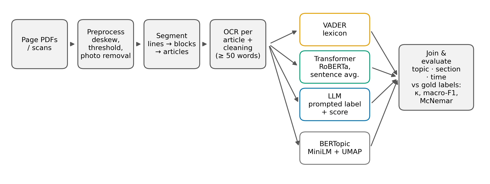

**What it shows:** the processing chain. Page image → cleaning (straighten, black-and-white, remove photos) → find the article blocks on the page → OCR (Tesseract) each article, clean the text, keep articles of ≥ 50 words → three sentiment methods and BERTopic in parallel → join everything and evaluate by topic, page section and time, plus against human ("gold") labels.

**How to say it:** "Every article is scored independently by three methods of increasing sophistication (a word list, a neural classifier and a large language model), and topics are found without supervision. We then compare the methods with each other and with human judgement."

**Likely questions:**
- *Where did the pages come from?* The Indian Express e-paper (paid subscription), downloaded automatically with a logged-in session. The tool picks the front page (skipping wrap-around advertisement "jackets") and the editorial page (titled "The Editorial Page", with the "Wordly Wise" column).
- *Why OCR, when the PDF has text?* The e-paper's text layer is garbled, so we OCR the page image. Average OCR confidence is 89.8 / 100.
- *Why ≥ 50 words?* Shorter fragments are captions, teasers or briefs, which carry too little text for a stable sentiment judgement.

### Fig 2: corpus profile (`output/figures/fig2_corpus_profile.png`)
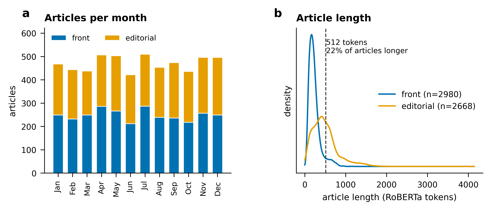

**Panel a, articles per month (stacked bars):** about 420–510 articles each month (front in blue, editorial in orange), so **every month is well represented** and month-to-month comparisons are not driven by tiny samples. The smallest month is June (422) and the largest July (510). Variation comes from the number of days, Sundays (no editorial), and how many stories fit on a page.

**Panel b, article length:** front-page articles are short (median **136 words**) because most continue inside the paper and we capture only the front-page part. Editorial articles are long (median **323 words**). The dashed line marks 512 tokens, the input limit of a RoBERTa model; **22% of articles are longer**.

**Likely questions:**
- *Doesn't the 512-token limit cut off long articles for the transformer?* No. We score **each sentence separately** and average, so no sentence comes near the limit and nothing is truncated. The line is there to show why sentence-level scoring was necessary. Claude Haiku reads up to 4,000 words per article, and no article in the corpus is that long, so Haiku also sees every article in full.
- *Front-page stories are cut off ("continued on page 8")?* Yes. Front-page sentiment is the sentiment of what appears **on the front page**, which is also what a reader of the front page sees. It is a stated limitation.

### Table: page_report.csv (`output/tables/page_report.csv`)
One row per page (663 rows). Columns:
- `articles_kept`: articles that passed all filters (average 8.5 per page; editorial 8.7, front 8.3).
- `candidates`: blocks the segmenter thought might be articles (8,321 in total). The difference consists of `dropped_short` (2,663 under 50 words) and `dropped_duplicate` (10).
- `mean_ocr_conf`: Tesseract confidence (mean 89.8).
- `photos_removed`: photographs blanked out before OCR (3,111 in total).
- `unreliable` / `flags`: automatic warnings. 244 pages have a flag, but **237 of those are only "1 kept article without a headline"**, which is harmless (usually an op-ed column or a short item whose headline was too stylised to find). The serious flags are few:
  - 3 front pages with **0 articles** (20 Jun, 29 Jun, 4 Dec). These are probably full-page advertisement layouts.
  - 3 pages flagged as a possible merge (one block holding most of the page's text).
  - 1 page with low OCR confidence.

  In total about 7 of 663 pages (≈1%) are genuinely problematic.

**Likely question:** *How do you know segmentation worked?* There are segmentation overlays for every page (`output/overlays/`, boxes drawn on the page), the per-page report above, and a visual check of the first week of results. Known residual errors: sidebars occasionally merge into the main story, and the tail of a column can be cut off by an inset box.

### Tables: topics.csv and topic_model_info.json
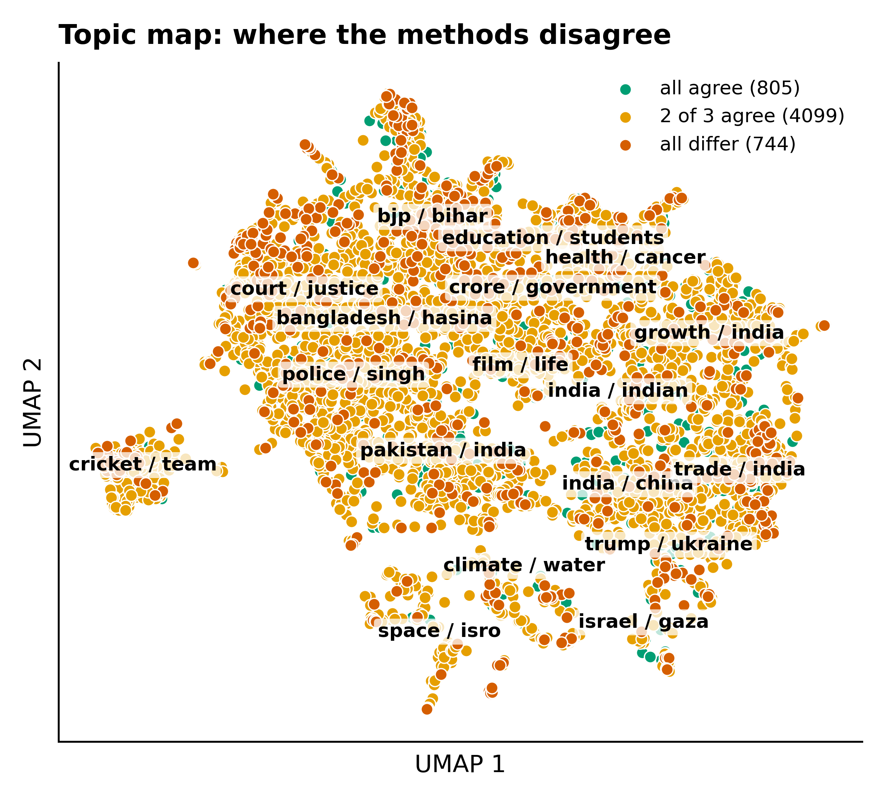

**What BERTopic does:**
1. Each article is turned into a 384-number "meaning vector" (MiniLM sentence embedding).
2. UMAP squeezes these into 5 dimensions, so articles about similar things sit close together.
3. HDBSCAN finds dense groups, which become the topics.
4. The topic's words are the terms most distinctive of that group (class-based TF-IDF).
5. The label is the top four words.

Settings: `min_cluster_size = 51` (about n/110) and `min_samples = 10`. Articles not placed in any group at first (37%) are assigned to their nearest topic, so every article has one.

**The 18 topics (n = articles):**

| # | topic | n | what it actually is |
|---|---|---|---|
| 3 | police / singh / minister / people | 799 | crime, accidents, local law and order (incl. Punjab, Rajasthan) |
| 0 | bjp / bihar / party / election | 751 | party politics, Bihar & Delhi elections |
| 5 | court / justice / police / case | 583 | Supreme Court / High Court cases |
| 2 | pakistan / india / terror / attack | 495 | Pahalgam attack, Operation Sindoor, Kashmir |
| 1 | trade / india / tariffs / trump | 420 | US tariffs, trade deals, Russian oil |
| 4 | growth / india / inflation / percent | 392 | economy, GDP, RBI, tax |
| 7 | india / china / modi / trump | 319 | diplomacy, PM visits |
| 8 | film / life / world / people | 311 | culture, columns, obituaries |
| 6 | cricket / team / india / world | 295 | cricket (Champions Trophy, Tests, women's World Cup) |
| 14 | crore / government / scheme / minister | 267 | government schemes, budgets |
| 9 | climate / water / air / india | 215 | pollution, climate, Indus Waters Treaty |
| 10 | education / students / school / children | 187 | education |
| 13 | trump / ukraine / russia / president | 121 | Russia–Ukraine war, US politics |
| 11 | health / cancer / patients / diseases | 117 | health |
| 16 | bangladesh / hasina / political / minister | 115 | Bangladesh politics |
| 12 | israel / gaza / iran / hamas | 96 | Gaza war, Israel–Iran war |
| 15 | space / isro / mission / indian | 84 | ISRO, Shubhanshu Shukla's spaceflight |
| 17 | india / indian / visa / research | 81 | US visas, Indian students abroad |

**Likely questions:**
- *Why 18 topics and not 10 or 50?* HDBSCAN decides the number itself from the density of the data. We chose the minimum topic size (≈1% of articles) so that topics are large enough to analyse yet distinct (the largest is 14%). With a smaller minimum size you get 40–60 very fine topics; with the original setting the whole year collapsed into 2 topics, which is useless.
- *Are topic labels your interpretation?* The four-word label is automatic. The "what it actually is" column above is my reading of the top words. Say "BERTopic produced 18 clusters, which we interpret as…".
- *Some topics overlap (Trump appears in 3 topics).* Yes. A topic is about the *main subject* of an article, and Trump appears in tariff, diplomacy and Ukraine stories alike.

The standard BERTopic charts (topic map, word bar charts, similarity heatmap, hierarchy, topics over time) are explained in **section 4b**.

---

## 3. How the methods compare (the core methodological result)

### Table: method_label_distribution.csv

| method | positive | neutral | negative |
|---|---|---|---|
| transformer | 2.0% | **91.5%** | 6.5% |
| VADER | **47.9%** | 20.0% | 32.1% |
| Claude Haiku | 20.1% | 34.5% | **45.4%** |

**Read it as:** run on the *same 5,648 articles*, the three tools give completely different pictures of the newspaper. Neutral, positive and negative newspaper, depending on which tool you use. **This is the main reason the method comparison matters:** a study that used only one of them would reach an opposite conclusion.

### Table: method_agreement.csv

| pair | label agreement | Cohen's κ | Spearman ρ (scores) |
|---|---|---|---|
| transformer – VADER | 25.8% | 0.06 | 0.61 |
| transformer – Haiku | 41.7% | 0.11 | **0.74** |
| VADER – Haiku | 47.8% | **0.24** | 0.54 |

**The key insight (expect a question on it):** the label agreement and κ are low, but the **Spearman correlations are moderate to strong** (0.54–0.74). In other words, the methods **largely agree on which articles are more negative or more positive** (the ranking), but **disagree on where to draw the lines** between positive, neutral and negative (the thresholds). The transformer and Haiku rank articles most similarly (ρ = 0.74), but the transformer puts the "neutral" boundary so wide that the labels rarely match.

### Fig 4: label flows and the effect of length (`output/figures/fig4_label_shifts_length.png`)
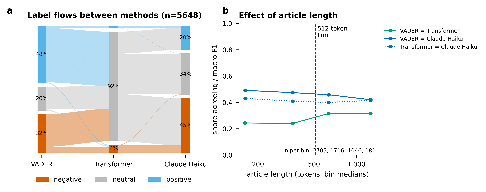

**Panel a (alluvial / Sankey):** three columns (VADER → transformer → Haiku), with each band showing how many articles move from one label to another.
- VADER's big positive block (48%) and negative block (32%) almost all flow into the transformer's **neutral** block (92%).
- From that neutral block, articles spread back out into Haiku's three labels: 20% positive, 34% neutral, 45% negative.
- So the transformer collapses distinctions that the other two methods make.

**Panel b (length):** agreement between pairs of methods across four length bins (bin medians ~150, ~400, ~700, ~1,200 tokens; n = 2,705 / 1,716 / 1,046 / 181).
- VADER–transformer agreement rises with length (0.24 → 0.32).
- VADER–Haiku agreement falls slightly (0.49 → 0.42).
- Transformer–Haiku agreement stays flat (~0.41).
- **Takeaway:** disagreement is **not** an artefact of long articles or truncation; it is present at every length.

**Likely question:** *VADER and Haiku agree most on labels (48%); doesn't that make VADER good?* No. Agreement between two methods says nothing about which is *right*. That is what the human labels are for (fig 3), and against them VADER is the weakest on accuracy (40%, below the 58% you would get by always answering "neutral").

### Chart: transformer_vs_vader.png
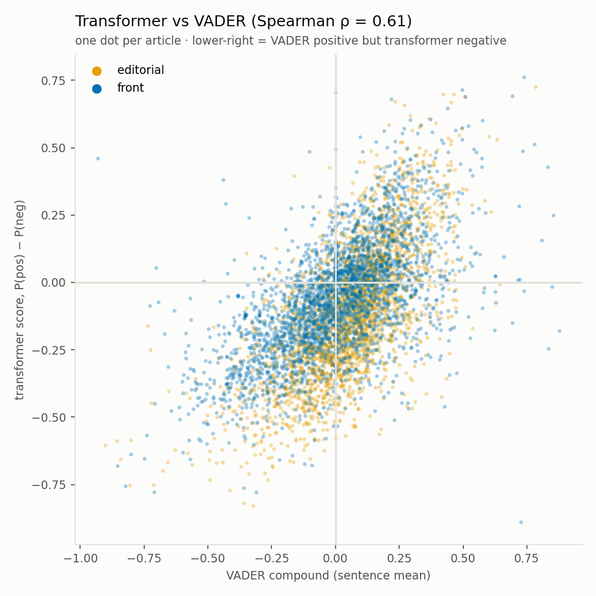

Each dot is one article (blue front, orange editorial). x is VADER's score, y is the transformer's score. The cloud slopes upward (Spearman ρ = 0.61), so the methods *broadly* rank articles alike. But note the large mass in the **lower-right quadrant**: VADER says positive (x > 0) while the transformer says negative (y < 0). Those are the articles where VADER's word counting is fooled, for example "security", "support" and "peace talks" in a story about violence. A few outliers (bottom right at x ≈ 0.7, y ≈ −0.9) are extreme cases of this.

### Fig 11: topic map of disagreement (`output/figures/fig11_umap_disagreement.png`)
(Shown in section 2.) Each dot is an article placed by meaning (UMAP of the embeddings), so nearby dots are about similar things. Colour shows whether the three methods agree: green **all agree (805, 14%)**, yellow **2 of 3 agree (4,099, 73%)**, red **all three differ (744, 13%)**.

**How to read it:** the red (full-disagreement) dots are spread across **all** topics, not concentrated in one corner. So disagreement is a general property of the methods, not a problem with one subject. Cricket forms its own island at the left (a very distinct vocabulary). Of the 805 articles where all three agree, most are neutral (440), then negative (267), then positive (98).

**Likely question:** *What do UMAP 1 and UMAP 2 mean?* Nothing on their own. They are just the two directions UMAP uses to lay out the map. Only distances (closeness) mean something, not the axes.

### Fig 3: accuracy against human labels (`output/figures/fig3_gold_standard.png`)
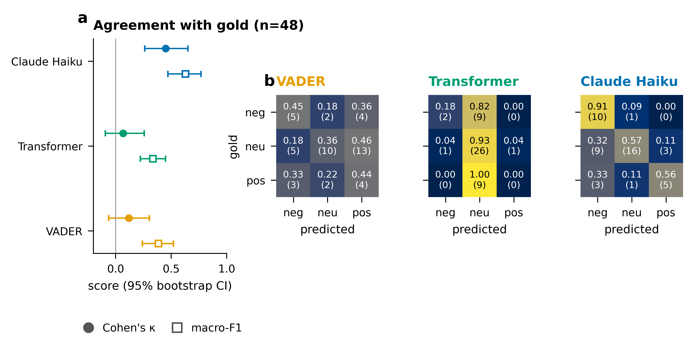

**This is the figure that decides which method to trust.** You hand-labelled 50 random articles from the first week of January (48 usable); the models' answers were hidden while you labelled.

**Panel a:** Cohen's κ (filled circle) and macro-F1 (open square) with 95% bootstrap confidence intervals.

| method | accuracy (95% CI) | macro-F1 | κ |
|---|---|---|---|
| **Claude Haiku** | **64.6%** (50–77%) | **0.63** | **0.45** (moderate) |
| Transformer | 58.3% (44–71%) | 0.34 | 0.07 (≈ chance) |
| VADER | 39.6% (27–54%) | 0.39 | 0.12 (slight) |
| *always say "neutral"* | *58.3%* | *0.25* | *0* |

**Panel b:** confusion matrices (rows = your label, columns = the method's label; the numbers are the share of each row, with counts in brackets).
- **Transformer:** almost everything lands in the "neu" column. It found 2 of 11 negative articles and **0 of 9 positive** ones. Its 58% accuracy is identical to always guessing "neutral", so it adds nothing.
- **VADER:** scattered. 13 of your 28 neutral articles became "positive"; only 5 of 11 negative ones were found.
- **Haiku:** caught **10 of 11 negative** articles (91%) and 5 of 9 positive ones. Its main error: **9 of your 28 neutral articles were called negative**, so Haiku is *stricter* than you, judging "factual report of bad news" as negative.

**Significance (McNemar):** Haiku beats VADER significantly (p = 0.017). Haiku vs transformer is *not* significant on 48 articles (p = 0.68): the transformer's accuracy is inflated by the many neutral articles, but the macro-F1 and κ gaps (0.63 vs 0.34; 0.45 vs 0.07) show Haiku is the only one that actually separates the three classes.

**Likely questions (prepare these well):**
- *Only 48 labels, and only from January week 1?* Yes, and it's the main limitation. The confidence intervals are wide (Haiku accuracy could be anywhere from 50% to 77%). The comparison is nonetheless clear on κ and macro-F1. A further 50-article random sample from the whole year has been prepared (`output/labelling/label_sample.xlsx`) to extend this check.
- *Only one labeller?* Yes. Inter-annotator agreement is not measured. Note that sentiment of news is subjective; even between humans, κ in the 0.4–0.6 range is common for 3-class news tone.
- *Is 65% accuracy good?* For three-class news *tone* (not product reviews), moderate κ ≈ 0.45 is a reasonable level. The point is the *comparison*: it is the only method clearly above the "always neutral" baseline on balanced measures.
- *Doesn't the LLM over-call negativity?* Partly, yes (see the 9 neutral→negative cases). So **Haiku's 45% negative share for the year is likely an upper bound**; treat the *relative* patterns (topics, months) as more reliable than the absolute level.
- *Labels came from the PDF version, while the year comes from scraped pages; is that a mismatch?* The articles are the same newspaper and the same pipeline; only the image source differs. OCR confidence is a little lower for scraped Jan–Mar pages (≈88 vs ≈93 for PDFs). Sentiment methods judge text, so the method ranking should carry over.

---

## 3b. Inside each method (`output/charts/methods/`)

These charts answer "why does each method give the result it gives?" and "how exactly do they differ?".

### score_distributions.png: how each method scores and labels the same articles
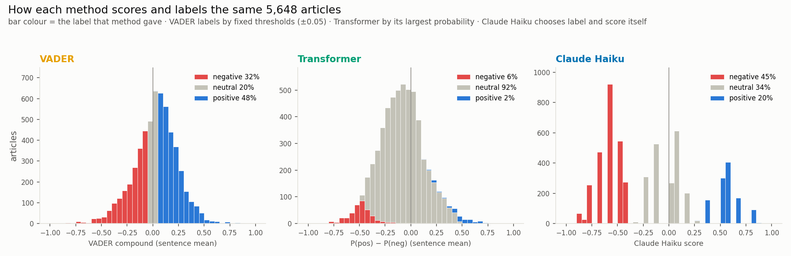

Three histograms of the score (−1 to +1), one per method; each bar is coloured by **the label that method gave**.
- **VADER:** a smooth bell centred slightly *above* zero. Its fixed rule (≥ +0.05 positive, ≤ −0.05 negative) leaves only a very thin neutral strip, so 48% land on the positive side and 32% on the negative. *Explains:* VADER's labels are mostly a question of which side of a tiny threshold an average word score falls on.
- **Transformer:** a bell centred slightly *below* zero (around −0.1), but almost all of it is **grey (neutral)**, even articles at −0.4 or +0.3. The label is "whichever probability is largest", and neutral nearly always wins. *Explains:* the 92% neutral. The transformer's *score* carries information (it ranks articles sensibly, as fig 4 and the scatter show), but its *label* does not.
- **Claude Haiku:** separate spikes (−0.8, −0.7, −0.6, −0.5 … +0.5, +0.6), because the model answers with rounded numbers. Its labels follow its score cleanly: negative ≈ −0.3 to −0.9, neutral ≈ −0.3 to +0.4, positive ≈ +0.3 to +0.9. The tallest spike is at **−0.6**. *Explains:* Haiku makes a confident, three-way decision rather than averaging words.

Likely question: *Why are Haiku's scores so "lumpy"?* The model is asked for a single number and, like a human, it picks round values. That is fine for ranking and averaging over many articles; just don't treat a 0.05 difference in one article's score as meaningful.

### score_scatter.png: do the methods rank articles the same way?
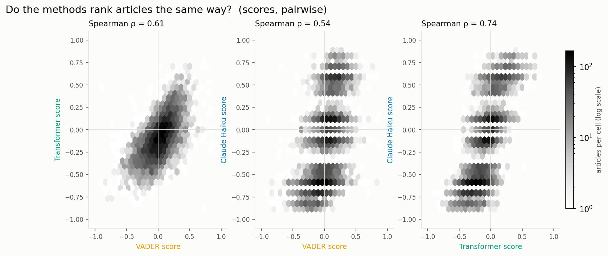

Three density plots (darker = more articles), one per pair, with Spearman ρ.
- **VADER vs Transformer, ρ = 0.61:** an elongated diagonal cloud, so they broadly rank articles alike.
- **VADER vs Haiku, ρ = 0.54:** horizontal bands (Haiku's rounded scores). Each band is spread widely along VADER's axis, so VADER's score varies a lot among articles Haiku judges identically.
- **Transformer vs Haiku, ρ = 0.74 (the highest):** the bands shift clearly from left (negative) to right (positive). The transformer's *score* agrees with Haiku quite well, even though its *labels* don't.

### label_crosstabs.png: where the labels go
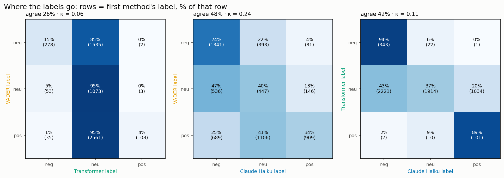

Three 3 × 3 tables. Rows are the first method's label and columns the second's; each cell shows % of the row with the count in brackets. The title gives raw agreement and κ.
- **VADER → Transformer (agree 26%, κ 0.06):** 95% of VADER-positive and 85% of VADER-negative articles become transformer-neutral.
- **VADER → Haiku (agree 48%, κ 0.24):** of VADER's **positive** articles, **25% (689)** are *negative* for Haiku, which is VADER's biggest failure. VADER-negative articles mostly stay negative (74%).
- **Transformer → Haiku (agree 42%, κ 0.11):** when the transformer *does* commit, it agrees with Haiku: 94% of its negatives are Haiku-negative and 89% of its positives Haiku-positive. Its neutral pile splits 43% negative / 37% neutral / 20% positive under Haiku.

**One-line summary:** *the transformer is accurate but timid (it rarely commits, and is right when it does); VADER is bold but often wrong (it calls a quarter of what Haiku sees as bad news positive).*

### label_distribution.png: label mix per method, all / front / editorial
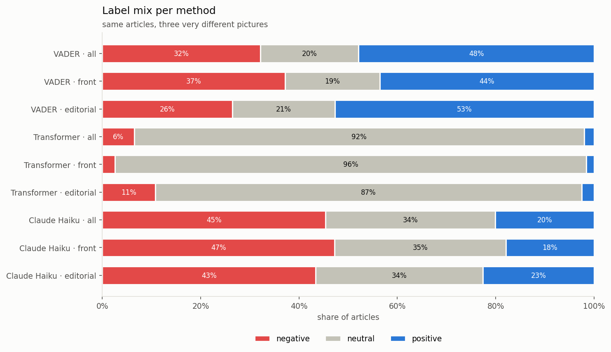

The method_label_distribution table as a picture, split by page type. VADER 32 / 20 / 48 (neg / neu / pos), the transformer 6 / 92 / 2, and Haiku 45 / 34 / 20. For page type, VADER and Haiku both make the front page more negative than the editorial page; the transformer does the reverse (section 5).

### agreement_by_topic.png: where the methods agree and where they don't
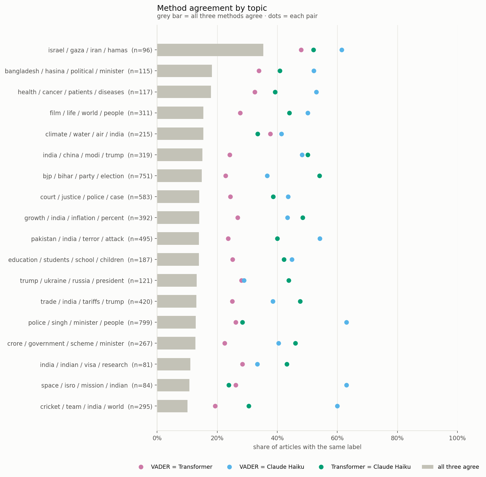

Grey bar = share of articles where **all three** agree; dots = each pair.
- **Highest all-three agreement:** Israel–Gaza–Iran (**35%**). Unambiguous war news is the one area where even word counting gets it right. Next come Bangladesh (18%) and health (18%).
- **Lowest:** cricket (10%), space/ISRO (11%) and visa (11%). These are positive-leaning topics where the transformer stays neutral.
- **VADER = Haiku** (blue dots) is highest for crime/police, space and cricket (about 60%), and lowest for Russia–Ukraine (29%), where VADER is misled by words like "peace", "talks" and "support".

### agreement_by_month.png: is the disagreement stable over time?
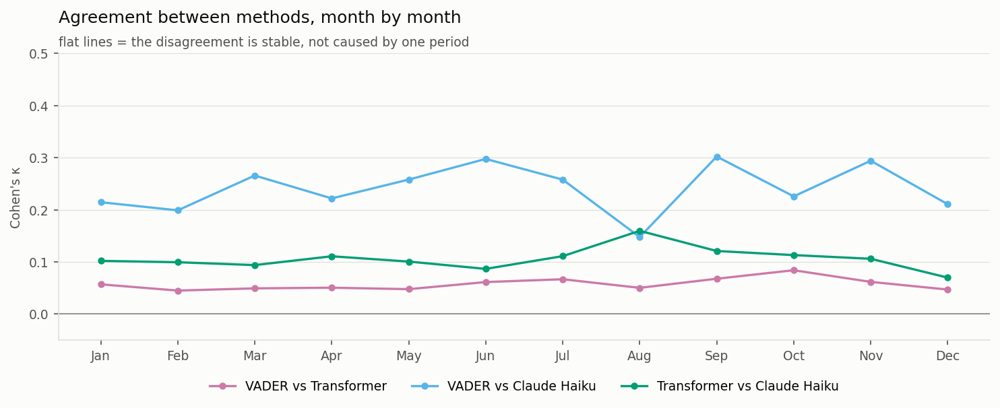

Cohen's κ per month for each pair. VADER–Haiku stays between 0.15 and 0.30, Transformer–Haiku between 0.07 and 0.16, and VADER–Transformer between 0.04 and 0.08. **The lines are flat, so the disagreement is a property of the methods, not of one period.** The single notable month is **August**: VADER–Haiku agreement drops to 0.15 while Transformer–Haiku rises to its highest (0.16). In the tariff coverage VADER saw positive trade and deal vocabulary that Haiku and the transformer read as negative.

### llm_reasons.png: why Claude Haiku chose each label
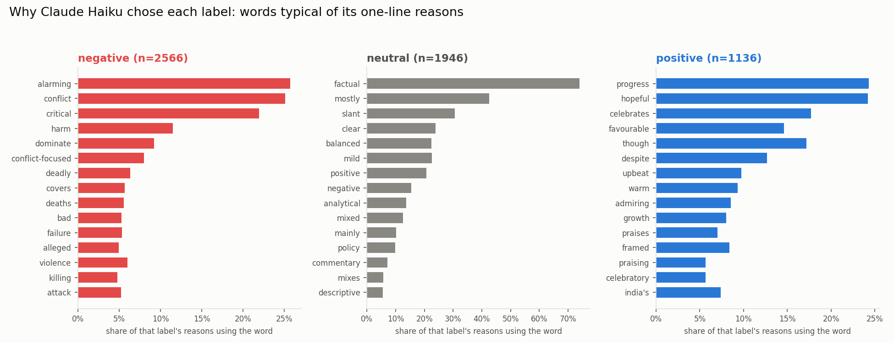

For every article Haiku also wrote a one-line reason. The chart shows the words most typical of each label's reasons (bar = share of that label's reasons using the word).
- **Negative:** "alarming" (26%), "conflict" (25%), "critical" (22%), "harm", "deadly", "deaths", "failure", "violence", "attack".
- **Neutral:** "factual" (**74%**), "mostly", "slant" (as in "no clear slant"), "balanced", "mild", "analytical", "mixed".
- **Positive:** "progress" (24%), "hopeful" (24%), "celebrates", "favourable", "upbeat", "praises", plus "though" and "despite" (positive *despite* some concerns).

**Why it matters:** Haiku's reasons use exactly the definitions in its prompt (critical / alarming / harm, factual / balanced, hopeful / progress). This is evidence that it applied the instructions rather than guessing, and it is the answer to "the LLM is a black box": every label in `articles.csv` comes with a written justification in the `llm_reason` column.

### vader_misleading_words.png: why VADER reads bad news as positive
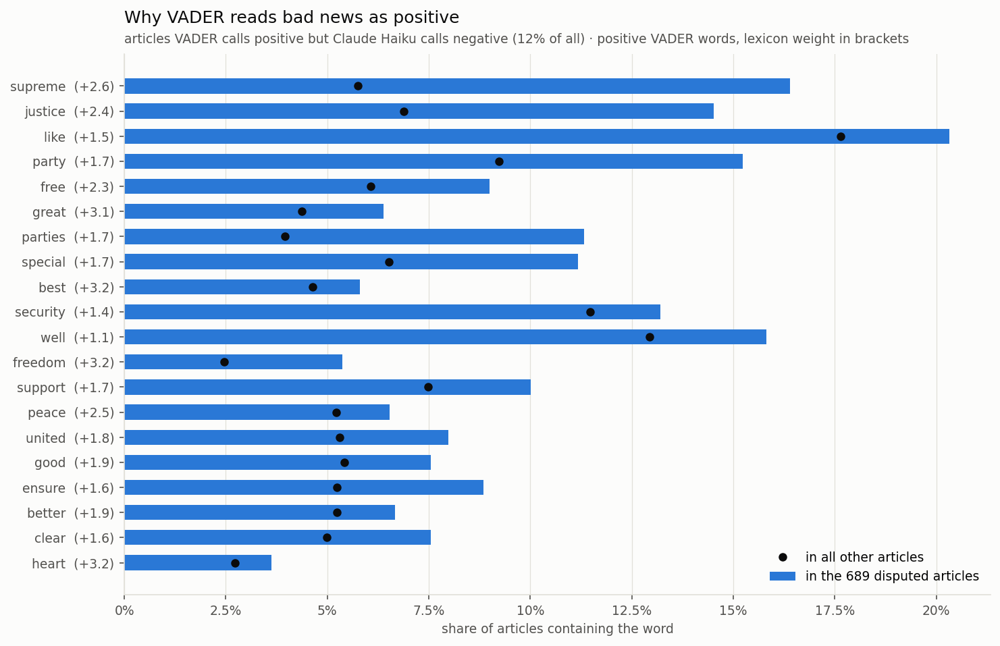

This takes the **689 articles (12%)** that VADER calls positive but Haiku calls negative, and lists the positive-valence VADER words they contain (VADER weight in brackets). The blue bar is the share of these disputed articles containing the word; the black dot is the share of all other articles.
- **"supreme" (+2.6) and "justice" (+2.4)** are about 3× and 2× more common in the disputed articles. They come from *Supreme Court* and *justice* in court and crime reports, which VADER scores as praise.
- **"party" / "parties" (+1.7)** come from political news ("ruling party", "opposition parties").
- **"united" (+1.8)** from *United States* / *United Nations*, **"security" (+1.4)** from *security forces*, **"free" (+2.3)** from *free trade* / *free and fair*, and **"peace" (+2.5)** from *peace talks* during wars.

**This is the clearest explanation of VADER's weakness:** it is a context-free word list built for social media, so the vocabulary of courts, politics and diplomacy pushes hard news towards "positive".

---

## 4. Sentiment by topic

### Chart: sentiment_by_topic.png (Claude Haiku)
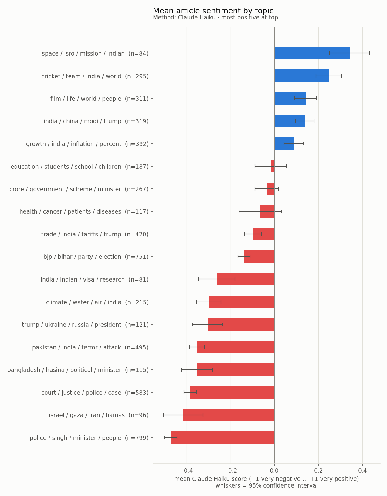

Topics are sorted from most positive (top) to most negative (bottom). The bar is Claude Haiku's mean score (−1 to +1); whiskers are 95% CIs; blue is above zero and red below.

| most positive | mean | | most negative | mean |
|---|---|---|---|---|
| space / ISRO | **+0.34** | | crime / police | **−0.47** |
| cricket | +0.25 | | Israel–Gaza–Iran | −0.41 |
| film / culture | +0.14 | | courts | −0.38 |
| India–China / diplomacy | +0.14 | | Bangladesh | −0.35 |
| growth / economy | +0.09 | | Pakistan / terror | −0.35 |
| | | | Russia–Ukraine | −0.30 |
| | | | climate / water / air | −0.30 |

- **Close to zero (CI crosses 0):** education −0.02, government schemes −0.03, health −0.06. These are genuinely mixed topics.
- Small topics (ISRO 84, visa 81, Gaza 96 articles) have wide whiskers, so don't over-interpret their exact rank.
- **Same ranking as the transformer:** the transformer's version of this chart also put ISRO and cricket at the top and Gaza, courts and crime at the bottom. Only the scale differs (transformer range about −0.28 to +0.13).

### Fig 5b: topic × method heatmap (the better version of the above)
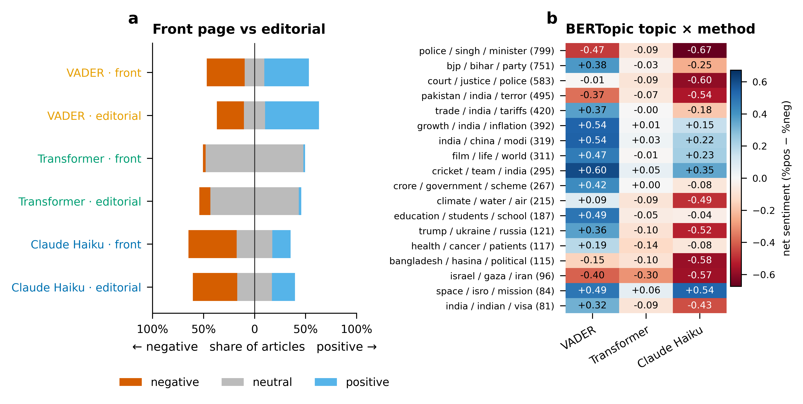

Each cell is net sentiment (% positive − % negative) for that topic under that method; blue is positive and red negative.
- **Haiku column:** crime/police **−0.67**, courts −0.60, Bangladesh −0.58, Israel–Gaza −0.57, Pakistan/terror −0.54, Russia–Ukraine −0.52, climate −0.49 … versus space/ISRO **+0.54**, cricket +0.35, film +0.23, diplomacy +0.22, growth +0.15.
- **VADER column:** shifted positive everywhere (economy +0.54, cricket +0.60), yet it still puts crime (−0.47), Israel–Gaza (−0.40) and Pakistan/terror (−0.37) at the negative end.
- **Transformer column:** almost all near 0 (because of the 92% neutral), but Israel–Gaza still stands out at −0.30.

**Takeaway:** the *order* of topics is similar across methods (good news: the topic ranking is robust); the *level* differs.

**Interesting disagreements to mention:** "trump / ukraine / russia" is +0.36 in VADER but −0.52 in Haiku, and "bjp / bihar / election" is +0.38 in VADER but −0.25 in Haiku. Political and diplomatic text uses many "positive" words (support, win, peace, alliance) while the overall tone is conflict, which VADER cannot see.

### Chart: methods_by_topic.png ("Do the three methods rank topics the same way?")
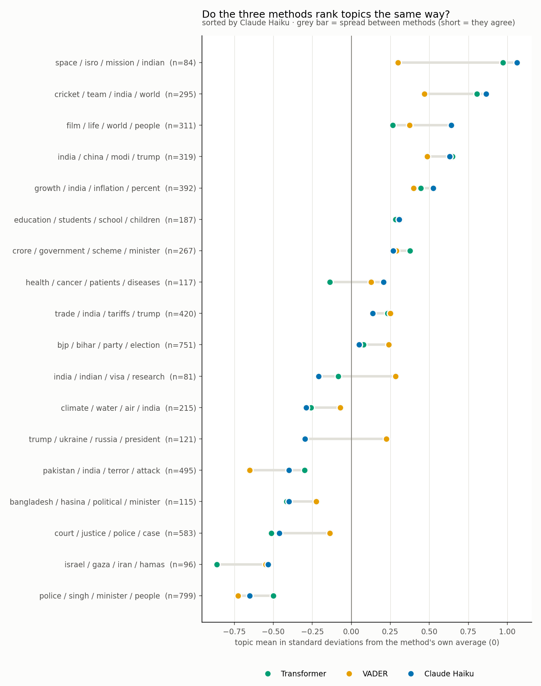

Each method's scores are **standardised** (0 = that method's own average; ±1 = one standard deviation). This removes the level differences and shows only each topic's *position relative to the others*. Dots: transformer green, VADER orange, Claude Haiku blue. Topics are sorted by Haiku. The **grey bar** spans the three dots, so a short bar means the methods agree.
- **Short bars (agreement):** education, government schemes, growth, India–China, crime/police, Bangladesh, climate.
- **Long bars (disagreement):** Russia–Ukraine (VADER well above average, Haiku well below), space/ISRO and cricket (VADER much less enthusiastic), courts (VADER near average, the others clearly negative), visa/research.
- In nearly every long bar, **VADER is the odd one out**. Section 3b shows why: legal and political vocabulary (Supreme, justice, party, peace, support) is "positive" in VADER's word list.

### Chart: labels_by_topic.png (Claude Haiku labels)
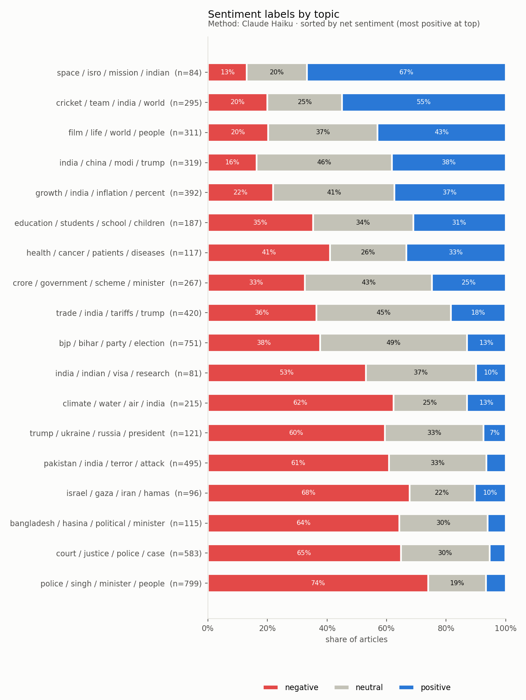

Stacked bars of negative / neutral / positive share per topic, sorted by net sentiment.
- **Most negative:** crime/police **74%** negative, Israel–Gaza 68%, courts 65%, Bangladesh 64%, climate 62%, Pakistan/terror 61%, Russia–Ukraine 60%.
- **Most positive:** space/ISRO **67%** positive, cricket 55%, film 43%, India–China 38%, growth 37%.
- **Most balanced:** education (35% negative / 34% neutral / 31% positive) and health (41 / 26 / 33).

### Table: sentiment_by_topic.csv
One row per topic, with all three methods. The most useful columns for the meeting:
- `mean_llm_score`, `llm_ci95_low/high`, `llm_net`, `share_llm_negative`: the Haiku view (what the charts show). Highest negative share: crime/police **74%**, Israel–Gaza 68%, courts 65%, Bangladesh 64%, climate 62%, Pakistan/terror 61%. Lowest: ISRO 13%, diplomacy 16%, cricket 20%, film 20%.
- `mean_headline_score`: the transformer on the headline only.
- `label_agreement_with_vader`: transformer–VADER label agreement within the topic (highest for Israel–Gaza at 48%, because there both see the bad news).

### Table: sentiment_topic_x_pagetype.csv
Mean score per topic split by front vs editorial: columns `editorial` and `front` are the transformer, and `llm_editorial` and `llm_front` are Claude Haiku. **Here the two methods disagree on direction for several topics**, which links to the trap question in section 5.

| topic | Haiku editorial | Haiku front | transformer editorial | transformer front |
|---|---|---|---|---|
| India–China | +0.04 | **+0.25** | 0.00 | +0.13 |
| Israel–Gaza | −0.46 | −0.29 | −0.34 | −0.15 |
| climate | −0.36 | −0.21 | −0.20 | −0.07 |
| Bangladesh | −0.26 | **−0.43** | −0.18 | −0.18 |
| Pakistan / terror | −0.29 | **−0.39** | −0.17 | −0.15 |
| BJP / Bihar | −0.08 | −0.18 | −0.08 | −0.06 |

Read it as follows. For **international and policy** topics (diplomacy, Gaza, climate, education, growth), the editorial page is more negative, because it criticises. For **conflict and politics** (Pakistan/terror, Bangladesh, BJP/Bihar, crime), the front page is more negative under Haiku, because it reports the attacks and violence directly while editorials analyse them.

---

## 4b. Topic-modelling charts (`output/charts/topics/`)

These are the standard BERTopic visualisations, drawn as static images from the final 18-topic model. The topics themselves were not re-fitted; the charts use each article's saved topic.

### topic_map.png: intertopic distance map
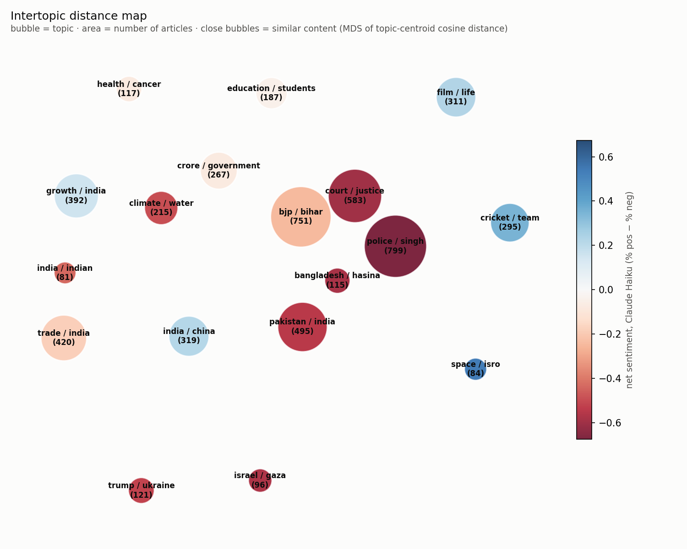

Each bubble is a topic. **Area = number of articles.** **Distance = how different the topics' content is**: each topic is the average meaning-vector of its articles, and the bubbles are laid out by MDS so that similar topics sit close together. **Colour = Claude Haiku net sentiment** (red negative, blue positive).
- The **centre cluster** is domestic hard news: BJP/Bihar, courts, crime/police, Pakistan/terror and Bangladesh sit close together, all red.
- The **economy and policy** group is on the left (growth, government schemes, climate, trade, visa), with **India–China diplomacy** next to trade.
- **Outliers** are the topics with their own vocabulary: cricket and space/ISRO (right, both blue), film/culture (top right), health and education (top), and the **foreign-war pair** Russia–Ukraine and Israel–Gaza (bottom).
- **Reading it in one sentence:** the negative topics form one dense block of domestic conflict, crime and politics, while the positive topics (sport, space, culture) are content-wise far away from it.

Likely question: *What do the axes mean?* Nothing on their own (like UMAP in fig 11). Only the distances matter.

### topic_barchart.png: what each topic is about
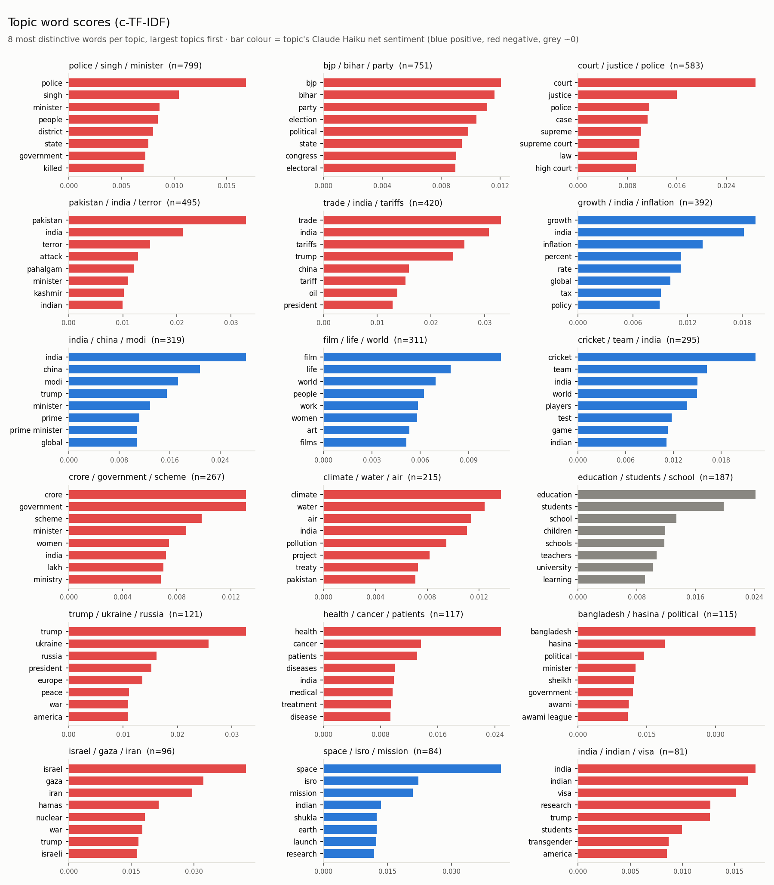

For each topic (largest first), the 8 words with the highest **c-TF-IDF** score. That is BERTopic's measure of how *distinctive* a word is for that topic compared with the other topics, not simply how frequent it is. Bar colour is the topic's Haiku sentiment.

These words are what justify the topic names. For example:
- Pakistan/terror: "pakistan, terror, attack, **pahalgam**, kashmir"
- Trade: "trade, **tariffs**, trump, china, **oil**"
- Space: "space, isro, mission, **shukla**, launch"
- Bangladesh: "bangladesh, **hasina**, sheikh, **awami league**"

Some generic words ("india", "minister", "government") appear in several topics because they are common in Indian news; the *topic-specific* words further down each list are what distinguish the topics.

### topic_heatmap.png: topic similarity matrix
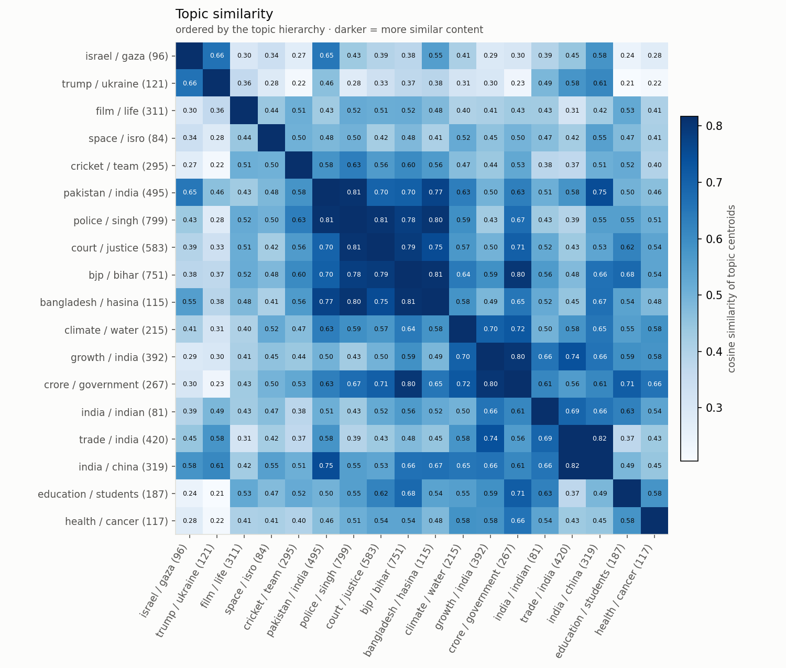

Each cell is the **cosine similarity** between two topics' average meaning-vectors (1 = identical content; darker = more similar). Rows are ordered by the hierarchy, so related topics sit next to each other and form dark blocks.
- **Most similar pairs:** trade ↔ India–China **0.82**, crime/police ↔ Pakistan/terror 0.81, crime/police ↔ courts 0.81, BJP/Bihar ↔ Bangladesh 0.81, BJP/Bihar ↔ government schemes 0.80, growth ↔ schemes 0.80.
- **Least similar:** Russia–Ukraine ↔ health 0.22, education ↔ Russia–Ukraine 0.21. These are completely different subjects.
- **Why it matters:** the topics are distinct but not isolated. The dark block of crime / courts / Pakistan / BJP / Bangladesh is the "conflict and politics" cluster that is also the most negative.

Likely question: *If trade and India–China are 0.82 similar, why are they separate topics?* They share the US–China–India context, but one is about tariffs and trade deals and the other about diplomacy and PM visits. HDBSCAN found them as separate dense groups. The hierarchy below shows they are the first pair to merge if you want fewer, broader topics.

### topic_hierarchy.png: how topics group into themes
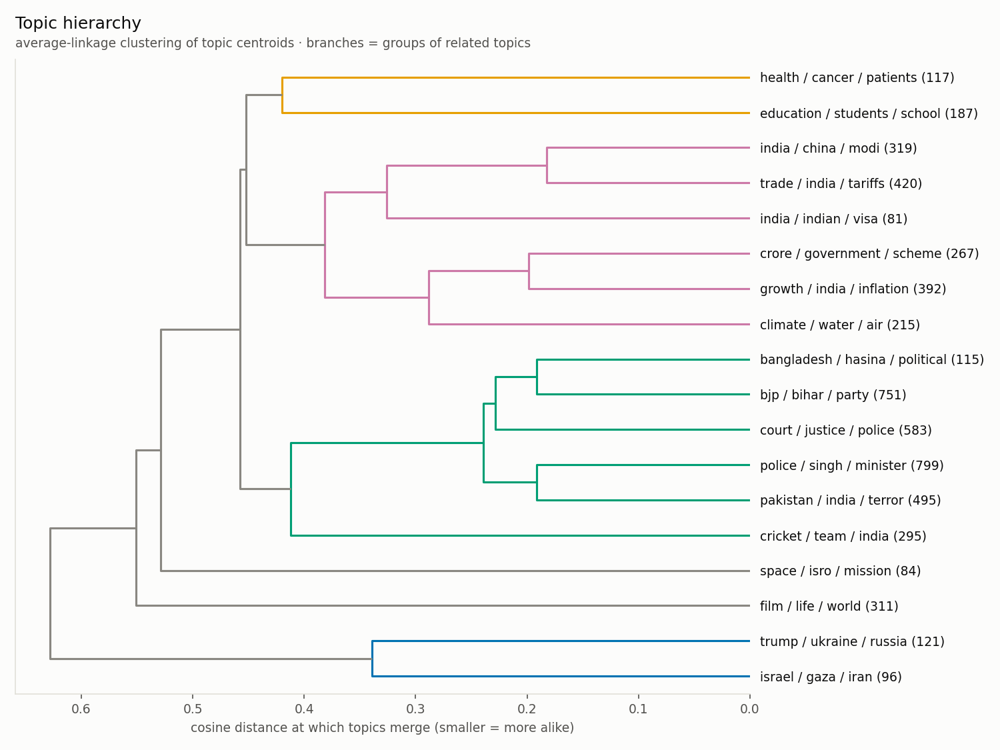

A dendrogram. Topics joined further to the right (smaller distance) are more alike; coloured branches are the main families.
- **Green family, conflict and domestic politics:** Bangladesh + BJP/Bihar, then courts; crime/police + Pakistan/terror; then cricket joins this family at a larger distance.
- **Pink family, economy and governance:** India–China + trade (the closest merge of all, about 0.18), then visa; government schemes + growth, then climate.
- **Orange:** health + education (social sector).
- **Blue:** Russia–Ukraine + Israel–Gaza (foreign wars).
- **Space/ISRO and film/culture** join last; they are the most distinct topics.

**How to use it:** "If we cut the tree into about 5 themes, we get domestic conflict & politics, economy & governance, social sector, foreign wars, and culture/science. Sentiment is lowest in the first and the fourth."

### topics_over_time.png: what the paper covered, month by month
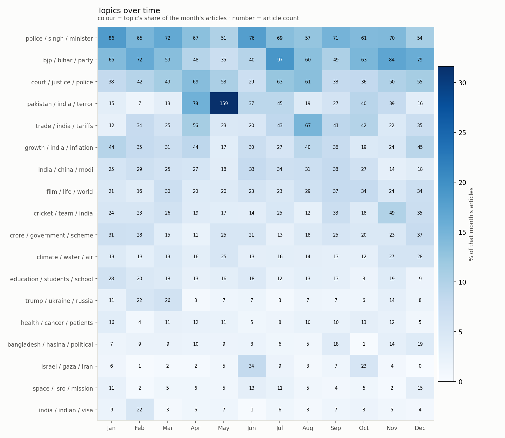

Rows are topics and columns months. Colour shows the topic's share of that month's articles, and the number is the article count.
- **Pakistan / terror:** 7–15 articles a month in Jan–Mar, then **78 in April and 159 in May** (32% of all May articles; the darkest cell). It stays elevated afterwards (37–45 in Jun–Jul, 40 in Oct–Nov).
- **Trade / tariffs:** peaks in **August (67)** and April (56), the tariff announcements.
- **Israel–Gaza–Iran:** **34 in June** (Israel–Iran war) and 23 in October (Gaza ceasefire), and almost absent otherwise.
- **Russia–Ukraine:** 22–26 in Feb–Mar (the US–Russia–Ukraine peace-talk diplomacy), then very low.
- **BJP / Bihar:** high all year, with peaks in **July (97)** and **November (84)**, the run-up to and results of the Bihar election.
- **Cricket:** 49 in November, the women's World Cup.
- **Crime / police:** a steady 51–86 every month, the "background noise" of news.

This chart is the evidence behind the monthly sentiment story: **months are negative when conflict topics crowd the paper.**

### topic_sentiment_by_month.png: how each topic's tone changed
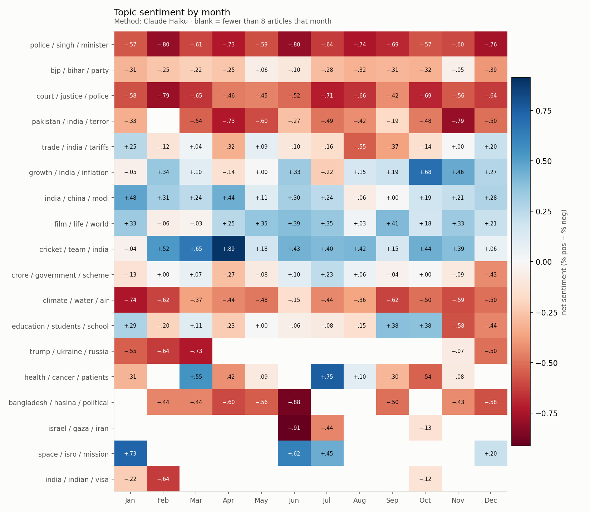

Each cell is Claude Haiku net sentiment (% positive − % negative) for one topic in one month. Cells are blank where the topic had fewer than 8 articles that month.
- **Crime / police and courts are negative every single month** (−0.42 to −0.80), so they are a constant drag.
- **Pakistan / terror:** −0.73 in April (Pahalgam), −0.60 in May, and **−0.79 in November**, which is the **Red Fort car blast (10 Nov)** and the "white-collar" terror-module investigation that followed.
- **Trade / tariffs:** mildly positive in January (+0.25), then **−0.55 in August** when the US doubled tariffs, and back to +0.20 in December.
- **Growth / economy:** turns clearly positive in **October (+0.68) and November (+0.46)**.
- **Cricket:** positive almost every month, peaking at **+0.89 in April**.
- **Israel–Gaza–Iran:** −0.91 in June (war), against −0.13 in October (ceasefire coverage).
- **Bangladesh:** −0.88 in June (the "push-back" of alleged illegal immigrants).
- **Education:** swings from +0.38 (Sep–Oct) to **−0.58 in November** (IIT rankings slipping, the doctor-specialist shortage).

**How to say it:** "The year's overall negativity is driven by a few persistently negative subjects (crime, courts, terror) plus event spikes; positive coverage comes from sport, science and, late in the year, the economy."

---

## 5. Front page vs editorial page

### Charts: sentiment_by_page_type.png and labels_by_page_type.png (Claude Haiku)
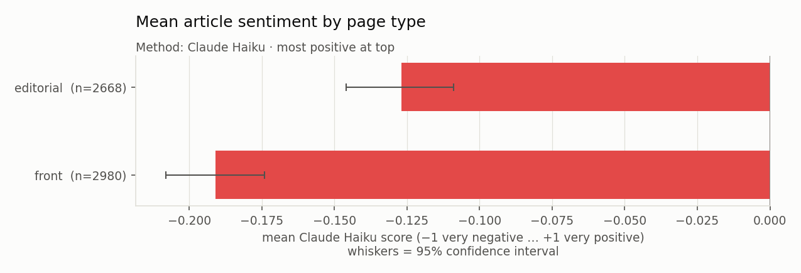
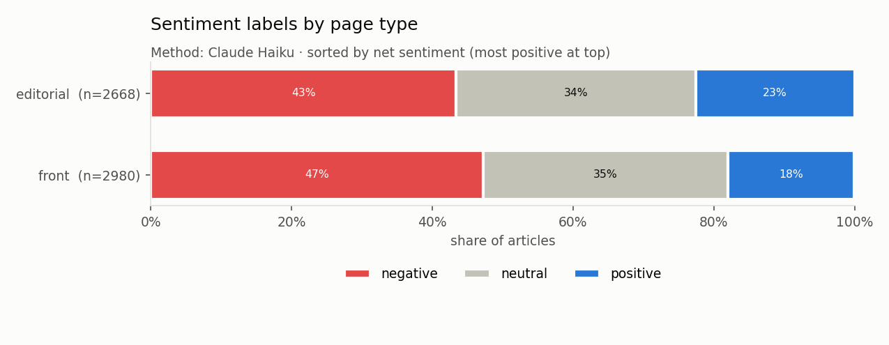

- **Claude Haiku:** front mean **−0.19** (CI −0.21 to −0.17) vs editorial **−0.13** (CI −0.15 to −0.11). The CIs don't overlap, so the **front page is significantly more negative** (Mann–Whitney p < 10⁻⁶). Labels: front 47% negative / 18% positive; editorial 43% negative / 23% positive.
- **Transformer (for comparison; in the tables):** the opposite direction. Editorial −0.111 vs front −0.065 (p < 10⁻¹⁴); editorial 10.8% negative vs front 2.6%.

### Fig 5a: front vs editorial for all three methods
Diverging bars: negative share to the left of 0 and positive share to the right, with neutral split across the middle, for each method × page type.

| | negative | neutral | positive |
|---|---|---|---|
| Haiku front | **47%** | 35% | 18% |
| Haiku editorial | 43% | 34% | **23%** |
| VADER front | 37% | 19% | 44% |
| VADER editorial | 27% | 21% | 53% |
| Transformer front | 3% | 96% | 2% |
| Transformer editorial | 11% | 87% | 3% |

(The month and event context in section 6, such as the Pahalgam attack, Operation Sindoor, the June Israel–Iran war, the US tariffs in August, the Gaza ceasefire and the women's World Cup, is general news background used to *interpret* the peaks. The data shows the topic volumes and sentiment; it does not itself "know" the events.)

### ⚠ The trap question: "Is the editorial page more negative or less negative than the front?"

**The methods disagree on direction.**
- The **transformer** says the editorial page is more negative.
- **Haiku and VADER** say the editorial page is *less* negative and *more* positive than the front page (Haiku: χ² = 19.9, p < 0.001; mean score front −0.19 vs editorial −0.13).

**How to explain it.** The front page is dominated by hard news: attacks, crime, court rulings, conflicts. Haiku reads that *content* as negative. Editorials discuss problems in critical, argumentative *language*, which the transformer picks up sentence by sentence, but they also propose solutions, praise achievements and look forward, which Haiku credits as positive.

**Safe answer:** "Under the method that best matches human judgement (Haiku), the front page is the more negative section, because it carries hard news. The transformer's opposite result reflects its sensitivity to critical *wording* rather than to the overall tone."

### Table: sentiment_by_page_type.csv
Two rows with all the numbers above (n, mean, CI, label shares, headline score, VADER mean, LLM mean and shares).

---

## 6. Sentiment over time

### Fig 6: sentiment by month, one panel per method (`output/figures/fig6_time_series.png`)
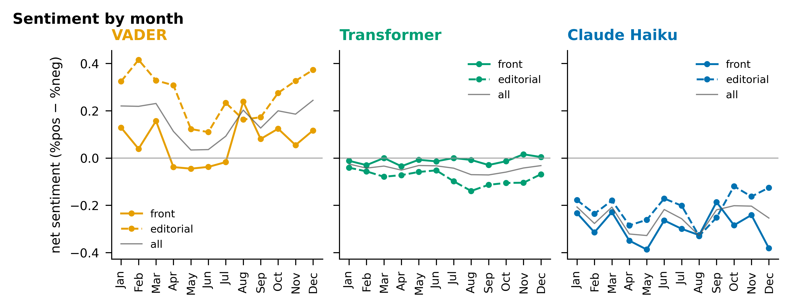

Net sentiment (% positive − % negative) each month. Solid line front, dashed line editorial, grey line all articles.

**Claude Haiku (right panel), the one to trust:**

| month | net | % negative | what happened |
|---|---|---|---|
| Jan | −0.21 | 43% | |
| Feb | −0.28 | 46% | |
| Mar | −0.21 | 44% | |
| **Apr** | **−0.32** | 49% | **Pahalgam terror attack (22 Apr)**; India–Pakistan coverage jumps from 3% to 15% of articles |
| **May** | **−0.33** | **50%** | **Operation Sindoor / India–Pakistan hostilities (7–10 May)**; India–Pakistan = **32%** of all articles that month (159 articles) |
| Jun | −0.22 | 45% | Israel–Iran war (34 Israel/Gaza/Iran articles, against ~5 in a normal month) |
| Jul | −0.26 | 46% | |
| **Aug** | **−0.33** | 47% | **US tariffs on India (doubled in August)**; trade articles peak (67), and trade coverage that month is net **−0.55** vs −0.11 in other months |
| Sep | −0.22 | 44% | |
| Oct | −0.20 | 43% | most positive month (Gaza ceasefire, cricket) |
| Nov | −0.20 | 44% | Bihar election results; cricket (women's World Cup win) |
| Dec | −0.25 | 45% | |

- **Is the month-to-month variation real?** Yes. Haiku labels differ significantly across months (χ² = 37.3, p = 0.022; Kruskal–Wallis on scores p = 0.005).
- **Is there a trend over the year (getting more negative or more positive)?** **No.** There is no significant linear trend (Spearman ρ = 0.01, p = 0.29). The pattern is **event spikes** around a stable negative baseline, not a drift.
- **VADER panel:** also dips in April–June (to +0.03 in May), so it agrees that the spring was the worst period, though at a positive level. The front-page line goes slightly below zero in April–July.
- **Transformer panel:** almost flat near zero. The editorial line is consistently below the front-page line (−0.04 to −0.14) and reaches its lowest point in August.

**The most negative single days (Haiku, days with ≥ 12 articles):**
- 24 Apr (−0.59; 83% negative): "Wedding, honeymoon, cremation…", "Tourists clamour to leave Valley" (Pahalgam aftermath).
- 10 May (−0.57; 94% negative): "Blackouts from Srinagar to Jaisalmer", "Pathankot … under attack again".
- 25 Apr (−0.56): Pahalgam victims; Pakistan suspends the Shimla pact.
- 23 Jun (−0.49): "B-2 bombers drop 'bunker busters'; US enters war, bombs Iran n-sites".

**The most positive days:**
- 29 Jan (+0.29): "Sharp gains in reading & math learning levels…" (education survey), "A recovery, and more".
- 9 Jun (+0.15): "Didi Ki Rasoi: How Bihar turned rural homemakers into food entrepreneurs".
- 13 Mar (+0.13): "IIT Dhanbad … 9 Indian institutes in QS global top 50", "India, Mauritius sign eight pacts".

These examples are powerful in a meeting, because they show the method responds to real events. For **which topic** drove each month, use the topic × month charts in section 4b.

### Chart: sentiment_by_month.png (Claude Haiku)
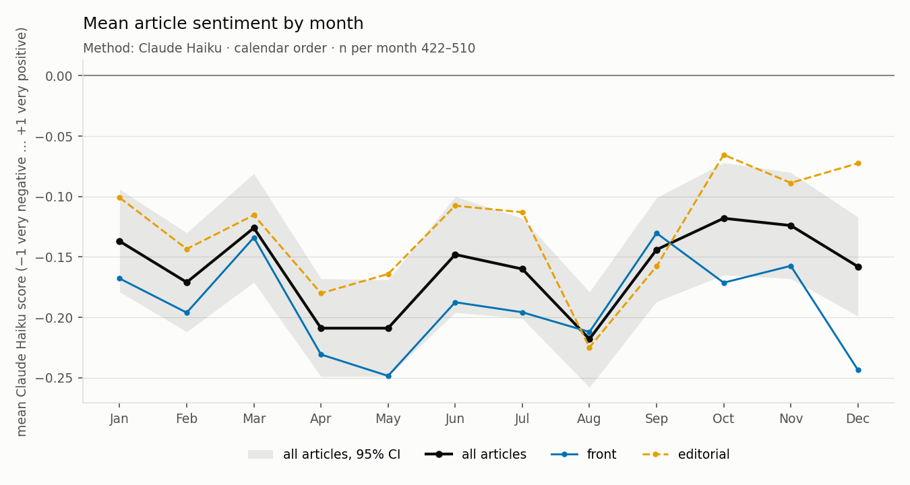

Calendar order. The black line is the mean Haiku score of all articles, with a grey band for the 95% CI; the blue solid line is the front page and the orange dashed line the editorial page.
- Every month is below zero (between −0.12 and −0.22).
- **Dips:** April and May (−0.21, Pahalgam / Operation Sindoor) and **August (−0.22, the lowest; US tariffs)**. **Peaks:** March (−0.13) and October (−0.12).
- The front page is below the editorial page in almost every month; the gap is largest in May (front −0.25) and **December (front −0.24 vs editorial −0.07)**. August is the one month where both are equally low (≈ −0.22), when the tariff story dominated both pages.
- Where the grey bands of two months don't overlap (for example Aug vs Oct), the difference is real. Neighbouring months mostly overlap.

### Chart: labels_by_month.png (Claude Haiku labels)
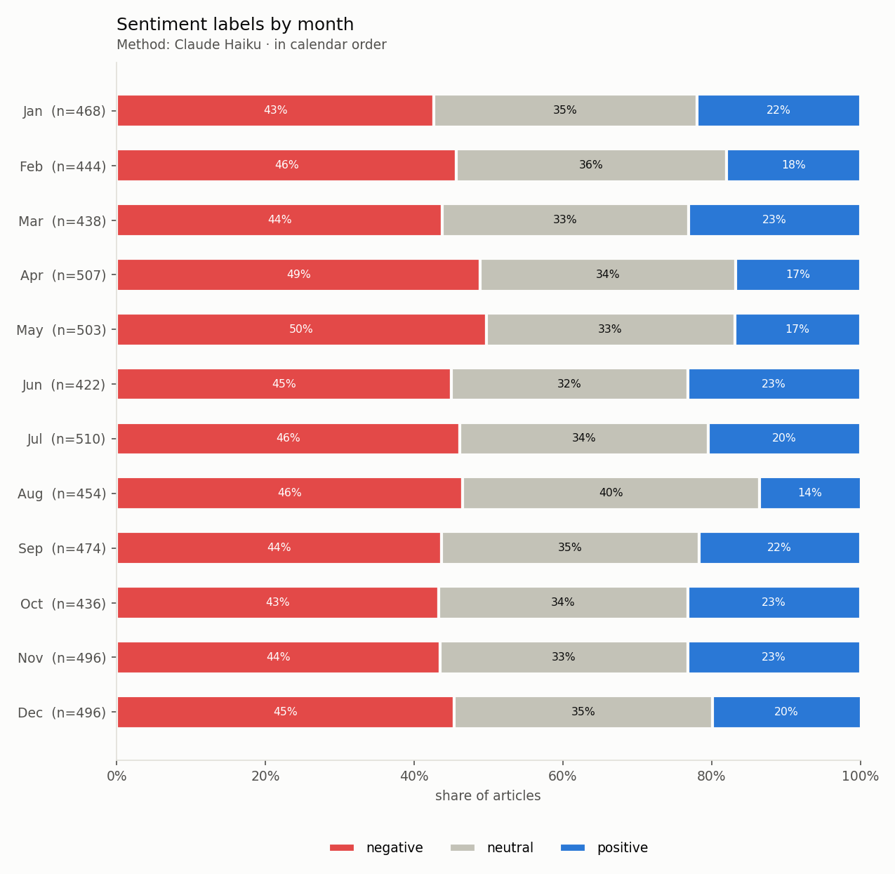

Calendar order, Jan at the top. The negative share stays in a narrow 43–50% band all year. It is highest in **May (50%)** and April (49%). August stands out for a *low positive* share (14%, the lowest of the year) rather than a high negative one. The steadiness of the bars is itself a finding: there is a stable baseline with event-driven bumps, not a trend.

### Chart: sentiment_by_date.png (Claude Haiku, daily)
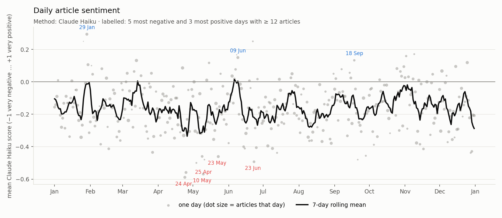

Each grey dot is one day's mean score (bigger dot = more articles that day); the black line is a 7-day rolling mean (article-weighted). The 5 most negative and 3 most positive days with at least 12 articles are labelled.
- **Red labels:** 24 Apr, 25 Apr (Pahalgam), 10 May (India–Pakistan hostilities), 23 May, 23 Jun (US strikes on Iran).
- **Blue labels:** 29 Jan (education survey gains), 9 Jun (rural women entrepreneurs), 18 Sep.
- The rolling line dips most sharply in **late April–May**, mid-June and late December, and comes closest to zero at the end of January, in mid-March, around 1 June and in early November.
- Days with very few articles (tiny dots) swing widely; don't read anything into a single small dot.

### Chart: labels_by_date.png (Claude Haiku, 7-day rolling label shares)
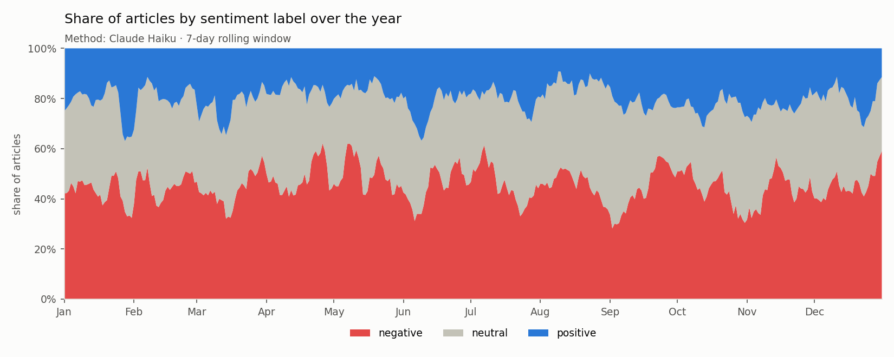

A stacked area of negative / neutral / positive share over a rolling 7-day window. The red (negative) layer peaks above 60% in **late April, early May and early July**, and drops to about 30% in **early June, early September and early November**. The blue (positive) layer widens at the end of January, in March and at the start of June. Use it to point to *when* sentiment shifted.

### Table: sentiment_by_month.csv
All the monthly numbers, for every method:
- `mean_score`, `share_*`: transformer.
- `mean_vader`: VADER mean compound.
- `mean_llm_score`, `llm_ci95_low/high`, `share_llm_*`, `llm_net`: Haiku (what the month charts show).
- `share_vader_positive`, `share_vader_negative`: VADER label shares.
- `label_agreement_with_vader`: transformer = VADER, about 23–28% each month.

---

## 7. Headline vs body

### Chart: headline_vs_body.png (transformer)
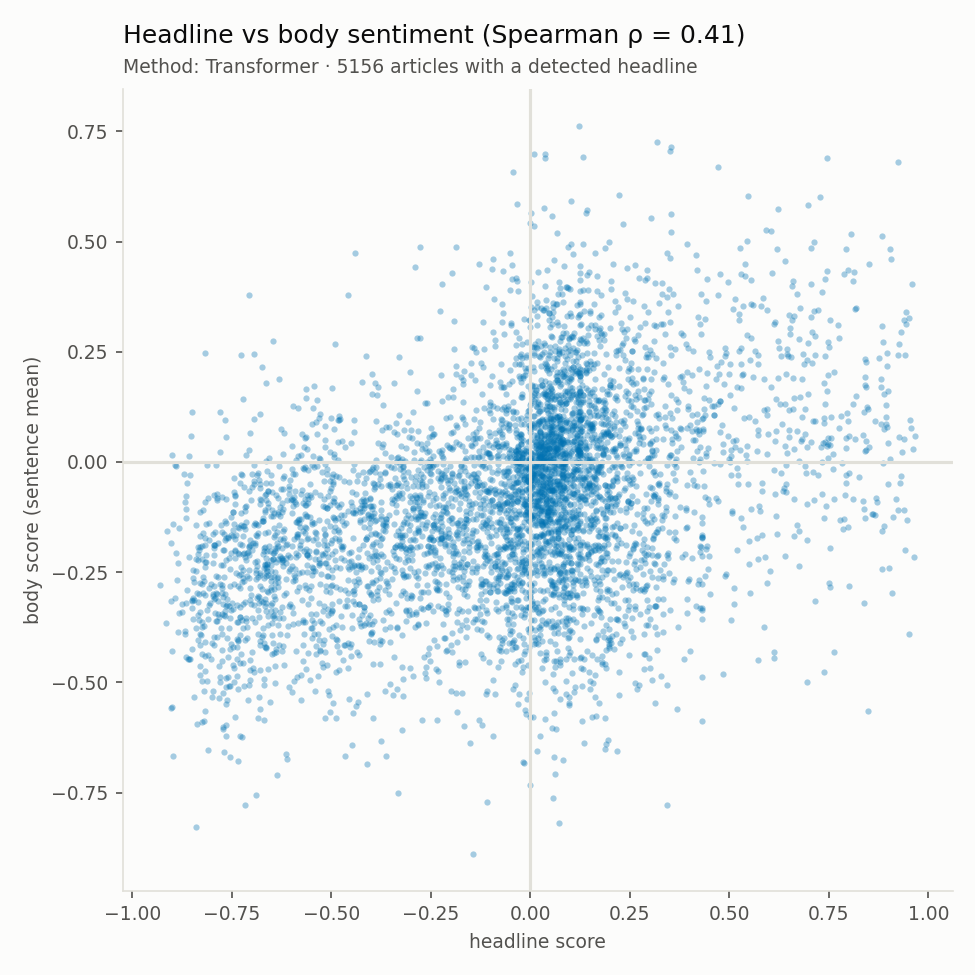

Each dot is an article with a detected headline (5,156 of 5,648). x is the headline's score and y is the body's average score.
- Spearman ρ = **0.41**, a positive but **moderate** relationship.
- Headlines spread across the whole range (−0.9 to +0.95), while bodies stay within about ±0.5. **Headlines are more extreme than the text below them**: a single short sentence can be strongly positive or negative, while a body averages many mostly factual sentences.
- In the table, front-page headlines average **−0.137**, more negative than front-page bodies (−0.065). Editorial headlines are *positive* on average (+0.043) despite more negative bodies (−0.111).
- The headline label differs from the body label for **27%** of articles.

**How to say it:** "Front-page headlines are framed more negatively than the stories underneath them, which is consistent with headlines being written to grab attention. Editorial headlines, by contrast, are often catchy or ironic phrases that the transformer reads as mildly positive."

**Caveat:** this uses the transformer only; a headline is one sentence, which the transformer handles well.

---

## 8. Cross-question bank (short answers)

**Methodology**
- *Why three methods?* They represent three generations: a dictionary (VADER), a fine-tuned neural classifier (RoBERTa) and an instruction-following LLM (Claude Haiku). Comparing them shows how much the conclusion depends on the tool.
- *Why Claude Haiku and not a bigger model?* Cost and speed: the whole year cost about $1.5 and took about an hour. Haiku is the smallest current Claude model, and the classification task is simple enough for it. A larger model was not tested.
- *Is the LLM deterministic and reproducible?* Every answer is cached (`output/llm_cache.jsonl`) with the model name, so the reported results are exactly reproducible from the cache. Re-querying could change a small number of labels.
- *What exactly does the LLM see?* The headline, the full article text (the cap is 4,000 words, and no article in the corpus is that long) and fixed written definitions of positive / neutral / negative ("tone, not whether you agree"), with the OCR noise acknowledged. It returns a label, a score and a one-line reason.
- *Is the transformer appropriate for news?* It was trained on tweets, which is one reason it does poorly. A news-specific model would probably do better. We report it as a commonly used off-the-shelf baseline.
- *Sentiment of a news article: whose sentiment?* The overall **tone of the text**, not the journalist's opinion and not the reader's reaction. That definition was given both to Claude and to the human labeller.

**Data**
- *Only the Jaipur edition?* Yes. The national front page and editorial are largely shared across editions, so this is close to the national Indian Express, but city pages differ.
- *Why front and editorial only?* The front page is what the paper chooses as most important (news agenda), and the editorial page is its own voice (opinion), so they are the two most informative pages.
- *Sundays?* There is no editorial page on Sunday, so Sundays contribute only the front page. Monthly totals are still comparable (all months have 4–5 Sundays).
- *Missing days?* 358 front pages were collected. 1 editorial page (23 Dec) could not be found, and 3 front pages yielded 0 articles.
- *Is OCR good enough?* Average confidence is 89.8; text is cleaned (line-break hyphens rejoined, page furniture removed), and the LLM is told to ignore small OCR errors.

**Findings**
- *Is the newspaper "negative"?* By Haiku, 45% of articles are negative and 20% positive. That partly reflects news itself (conflict and crime are newsworthy), and Haiku is slightly stricter than a human (it labelled 9 of 28 human-neutral articles as negative), so the true share is likely somewhat lower.
- *Did sentiment get worse during the year?* No overall trend; there were sharp negative spikes in April–May (Pahalgam / Operation Sindoor), June (Israel–Iran), August (US tariffs) and, for the terror topic, November (Red Fort blast).
- *Which topic is the most negative?* Crime/police (74% negative by Haiku) and Israel–Gaza (68%). The most positive is space/ISRO (67% positive).
- *Is a difference significant?* Front vs editorial: yes (p < 0.001), but the direction depends on the method. Month differences: yes for Haiku (p ≈ 0.02). Topic differences: the CIs in `sentiment_by_topic.png` don't overlap between the top and bottom topics.

**If you don't know an answer:** "That's a good point; it isn't something we measured, but the data is all in `articles.csv`, so we can check it."

---

## 9. Chart inventory (what to show, and in what order)

**Suggested order for a meeting (about 12 slides):**
1. Fig 1: pipeline.
2. Fig 2: corpus (how much data, and that it's balanced across months).
3. `methods/label_distribution.png`: "three tools, three different newspapers".
4. Fig 3: accuracy against humans, which is why we trust Claude Haiku.
5. `methods/label_crosstabs.png` and `methods/vader_misleading_words.png`: *why* the others fail.
6. `topics/topic_map.png`: the 18 topics at a glance.
7. `topics/topic_barchart.png`: what the topics are (backup slide).
8. `sentiment_by_topic.png` or fig 5b: the most robust finding, the topic ranking.
9. `sentiment_by_month.png` and `topics/topics_over_time.png`: the event-driven year.
10. `topics/topic_sentiment_by_month.png`: which topic drove which month.
11. `sentiment_by_date.png`: the named worst and best days.
12. `sentiment_by_page_type.png` + fig 5a: front vs editorial (prepare the trap question).

**Backup slides for cross-questions:**
- `methods/score_distributions.png`: why the transformer says neutral.
- `methods/score_scatter.png`: the methods rank articles similarly.
- `methods/agreement_by_month.png`: the disagreement is stable over time.
- `methods/llm_reasons.png`: answers "the LLM is a black box".
- `topics/topic_heatmap.png` and `topic_hierarchy.png`: why 18 topics and how they group.
- Fig 4 and fig 11: disagreement is not caused by length or by any one topic.
- `headline_vs_body.png`: headline framing.

**Known small caveats in the charts:**
- `sentiment_by_date.png`: days with very few articles swing widely; read the rolling line, not single small dots.
- `topic_sentiment_by_month.png`: cells with 8–15 articles are indicative only.
- Topic labels are automatic (top words); "what it actually is" in section 2 is our interpretation.

All charts are rebuilt from `output/articles.csv` with `.venv/bin/python make_charts.py` (summary, method and topic charts) and `.venv/bin/python make_figures.py --labels output/labelling/label_me.xlsx --gold-run output_jan_week_pdf` (paper figures). Neither re-runs OCR or Claude Haiku.
